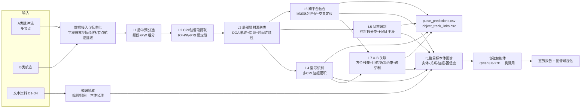

# B04《目标本体表征与多源数据融合》技术方案（初赛 v0.1）

> 编写日期：2026-11-17　｜　依据：赛题任务详情（11-15版）、初赛技术方案模板（11-12版）、P1A 配套资料 D1–D4、选手代码模板 V2、P1A_train / P1A_test 数据探查结果。
> 本文是团队内部的技术路线与工程计划；对外提交的《技术方案报告》将按官方模板五章结构另行成稿。

---

## 1. 赛题理解

### 1.1 任务一句话
给定多个本方观测节点（A 类：被动接收脉冲，含 TOA/RF/PW/幅度/DOA/节点位置）与另一信息源的目标航迹（B 类），完成：
**脉冲分选（每节点局部聚类）→ 型号识别 → 工作状态识别 → 跨平台融合（多节点同一辐射源归并）→ A-B 跨源关联 → 本体化表征 → 态势报告生成**。

### 1.2 输入 / 输出
| 类别 | 内容 |
|---|---|
| 输入 | A 类脉冲 CSV、B 类航迹 CSV、场景配套文本（D1 场景/公告、D2 型号手册、D3 传感器说明、D4 报告模板） |
| 输出1 | `[场景]_[版本]_pulse_predictions.csv`：`scenario_id,data_version,pulse_id,local_cluster_id,object_id,target_class,target_state`，每个 pulse_id 恰好一行 |
| 输出2 | `[场景]_[版本]_object_track_links.csv`：`scenario_id,data_version,object_id,track_id,link_status`；`matched/no_match`；一条航迹最多关联一个对象；no_match 时 track_id 为空；不得删对象/脉冲 |
| 输出3 | 态势报告（PDF，中文，≤8000 字，结论需引用 object_id/track_id 并能与结果表核对） |

### 1.3 评分与赛程
- **总分 = 0.8 × 机器评分 + 0.2 × 专家评分**。
- 机器评分 5 维：①聚类识别准确率 ②类型识别准确率 ③状态识别准确率 ④跨平台融合准确率 ⑤A-B 跨源关联准确率（具体公式未公布，评分器"依据对象成员关系"评价 → 编号可自定，需对置换不敏感的指标）。
- 专家评分：方案完整性、先进性与创新性、可行性、态势报告效果、应用价值。
- A 榜：11-16 ~ 12-15 24:00，**每日 ≤1 次、总 ≤15 次**，以**最后一次**提交为准。
- 12-15 前交付：态势报告 PDF、技术方案 PDF（正式版盖章 + 盲审版去身份）、Docker 代码包。
- A 榜前 30 → 主办方用**最后上传的代码包**跑 B 榜（P1B-test 不公开）→ B 榜 80% + 专家 20% 取前 10 进复赛。
- **结论：B 榜是在未知场景上直接运行我们的容器**，算法必须对场景参数（时长、节点数、平台数、公告区域）无硬编码、鲁棒泛化，不能依赖针对 P1A_test 的人工调参。

### 1.4 硬约束（违反即无效/0 分）
1. 包结构：`Dockerfile / run.sh / requirements.txt / README.md / src/ / output/`（config 可选），zip 命名 `<team>_code_<ver>.zip`。
2. 入口 `/app/program/solution/run.sh`，参数含 `--task`（缺省 all）、`--test`、`--out-dir`（缺省 `/output`）；输入只读挂载 `/input`（`DATA_ROOT`）。
3. 大模型只能通过注入的 `LLM_BASE_URL / LLM_API_KEY / LLM_MODEL / LLM_USE_JSON_SCHEMA / LLM_ENABLE_THINKING` 调用（qwen3.8-27b），**不得写死模型名/地址/key**，限流 120 次/分钟；无注入时必须优雅降级。
4. 超时、构建失败、格式不符均为无效提交且计次；运行时限/内存上限官方未明示 → 需尽快确认，按"10 分钟内、≤16 GB"自我约束。
5. 不使用隐藏真值、不对测试数据人工标注。

---

## 2. 数据洞察（P1A_train / P1A_test 实测）

### 2.1 规模
| 数据 | 行数 | 时长 | 备注 |
|---|---|---|---|
| P1A_train A | 15,869,054 脉冲（1.9 GB） | 500 s（09:00:00 起） | 含 target_id/class/state 真值 |
| P1A_train B | 4,009 点 / 12 条航迹 | 500 s | 含 target_class/target_id |
| P1A_test A | 8,600,592 脉冲（0.9 GB） | 300 s | 无真值 |
| P1A_test B | 3,313 点 / 16 条航迹 | 300 s | target_class 全空 |

字段坑：实际列名为 **`sensor_lontitude` / `target_lontitude`（拼写错误）**，与文档 `longitude` 不一致，读取时需兼容两种写法；pulse_id 全局唯一且连续；各节点内 TOA 单调递增，TOA 以场景起点为零点、单位 μs，**各节点共用同一时基**。

### 2.2 观测节点（A 类 platform_id）
| 节点 | 类型 | 高度 | 训练集脉冲数 | 说明 |
|---|---|---|---|---|
| 103001 | 空中 | 4500 m | 1.21 M | 机动，DOA 误差 ±1.5° |
| 103002 | 空中 | 4500 m | 1.46 M | 训练集约 7.9 s 后才开始有数据 |
| 104001 | 海面 | 0 | 6.48 M | 低速，DOA 误差 ±3° |
| 104002 | 海面 | 0 | 6.72 M | |

接收视场 = 节点航向 ±60°；被观测雷达只向本平台航向 ±60° 扇区发射 → **"能收到"本身就是几何约束**（节点须在目标前向扇区内，目标须在节点视场内）。

### 2.3 训练集真值结构
- 11 个有辐射的目标：空中 103003–103008（R01×2、R02、R03×2、R04），海面 104003–104008（R05×2、R06、R07、R08；**104007 无脉冲**）。
- 同型号多实例确实存在（R01×2、R03×2、R05×2）→ 必须靠 DOA/时间连续性/航迹区分。
- A-B 对应：103003↔1、103004↔2、103005↔3、103006↔4、103008↔5、104003↔7、104004↔8、104006↔9、104008↔11。
- **无航迹的对象**：103007（R03）、104005（R06）→ `no_match`。
- **无对象的航迹**：6（F1，虚假）、12（F2，虚假）、10（104007，全程静默雷达）。与 D3"B 源可能含无对应实体或质量异常的航迹"一致。
- 测试集 B：16 条航迹（空中 8 条，高度 2400–4000 m；海面 8 条），规模大于训练集。
- B 航迹采样 1 s 或 2 s，位置有明显噪声（逐点差分速度虚高），航迹级速度/航向需平滑估计。

### 2.4 波形指纹（型号判别核心依据，训练集统计）
| 型号 | 平台类别 | RF 范围 (MHz) | RF 方式 | PRI 取值 (μs) | PW 取值 (μs) |
|---|---|---|---|---|---|
| R01 | 巡查飞行器 | 35157–35323 | 脉组捷变 | {64,72,80,90,100,112} | {0.8,1.2,1.6} |
| R02 | 巡查飞行器 | 35237–35402 | 脉组捷变 | {80,90,100,120,136,152} | {1.2,1.6,2.0} |
| R03 | 中继飞行器 | 31267–31373 | 组变（离散） | {240,270,300,330,360,400} | {1.0,1.5,2.0} |
| R04 | 中继飞行器 | 31307–31413 | 组变（离散） | {270,300,330,360,420,450} | {1.5,2.0,2.5} |
| R05 | 工作艇 | 35337–35393 | 组变 | 抖动 ≈400±~17 | {0.4,0.8,1.2} |
| R06 | 工作艇 | 35377–35433 | 组变 | 抖动 ≈400±~17 | {0.8,1.2,1.6} |
| R07 | 勤务船 | 28857–29003 | 脉组捷变 | {460,520,580,640,700,780} | {0.5,1.0,1.5} |
| R08 | 勤务船 | 28877–29023 | 脉组捷变 | {520,580,640,700,820,860} | {1.0,1.5,2.0} |

（PW 观测值含 ±0.1 μs 均匀误差，RF 含 ±0.5 MHz 均匀误差；幅度 param3 随距离/波束指向变化，范围 24.5–83 dBm。）
→ 四个频段先天可分；同频段两型号靠 **PRI 集合 + PW 集合 + RF 子范围** 的多 CPI 联合分布区分，与 D2"需综合多个 CPI"一致。B 榜可能出现新的取值，故指纹库应**从训练数据自动学习 + 文本规则兜底**，而非硬编码。

### 2.5 工作状态特征（按"驻留段"统计）
| 状态 | 驻留段脉冲数(中位) | 段时长(中位) | 段内 RF 标准差 | 平均幅度 |
|---|---|---|---|---|
| 0 搜索 | 320 | ~160 ms | ~26 MHz（段内多个 CPI 跳频） | ~32 dBm |
| 1 粗跟 | 64 | ~25 ms | ~1.4 MHz（段内 RF 不变） | ~45 dBm |
| 2 精跟 | 64/128 | ~29 ms | ~1.5 MHz | ~52 dBm |

- 搜索：波束扫过本方节点 → 长段、跨多个 CPI、幅度低；跟踪：波束持续指向被跟踪目标 → 短而规则（每秒 512/768 脉冲周期结构）、幅度高（被跟踪对象若正是本方节点则幅度显著升高）。
- 时序上呈 **0 → 1（短暂，约 1 s 量级）→ 2**，并有 2 中穿插 0 的情况 → 适合 HMM/序列平滑。
- 状态 1 样本极少（约 1.5%），区分 1/2 是难点，需利用"首次进入跟踪后的短时窗"等时序先验。

### 2.6 跨节点同源脉冲（跨平台融合的关键发现）
同一发射脉冲被两个节点同时接收：**RF、PW 一致，TOA 差仅为传播时延差（实测 −60~0 μs，量级 = 基线/光速）**，而 DOA 不同（可交叉定位）。由于 RF 按 CPI 随机捷变，"RF+PW+TOA 差 < 基线/c"的跨节点同源匹配具有极强判别力，可作为跨平台融合与定位的主证据。

---

## 3. 总体技术架构



设计原则：
1. **确定性核心 + 智能体外环**：五项机器评分全部由可复现的信号处理/统计学习流水线产出，不依赖 LLM（避免限流、不确定性、B 榜超时）；LLM 负责文本知识理解、证据组织、冲突解释与报告生成。
2. **证据驱动的本体**：每个结论（对象、型号、状态、关联）都挂载证据节点（脉冲统计、匹配脉冲数、方位残差、规则引用）与置信度，报告从图谱中"引用"而不是"编写"事实。
3. **无场景硬编码**：节点数、时长、型号库、阈值均从数据/配置推导。

---

## 4. 关键技术

### 4.1 脉冲去交错与局部聚类（→ local_cluster_id，聚类准确率）
1. **频段+PW 预分选**：按 RF 自动聚成频段（当前 4 段），段内按 PW 离散值分层，大幅降低交错密度。
2. **CPI 提取**：在每个"节点×频段"流内，以 TOA 序列做 PRI 搜索（CDIF/SDIF 直方图 + 序列跟踪），提取"RF 恒定(±0.5)、PW 恒定(±0.1)、PRI 恒定或在抖动窗内"的脉冲串作为 CPI；对 R05/R06 类抖动 PRI 采用均值±抖动窗口的宽容差跟踪。
3. **段 → 辐射源**：在 CPI/驻留段层面构图，边权综合：DOA 时间连续性（海面节点 ±3°、空中 ±1.5° 误差模型 + 方位变化率）、型号指纹兼容性、幅度连续性、时间不重叠约束（同一辐射源同一时刻只能处于一个 CPI）。采用"多目标方位跟踪（Kalman + 门限关联）"或图聚类（Leiden / 约束凝聚聚类）合并为局部辐射源。
4. **同型号多实例分离**：同指纹的段按 DOA 轨迹拆分（训练集 R01×2、R03×2、R05×2 用于验证）。
5. **兜底**：未能归入 CPI 的孤立脉冲按最近邻（时间+DOA+RF+PW）分配，保证每个 pulse_id 有输出。

### 4.2 型号识别（→ target_class）
- CPI 级特征：RF 均值、PW 值、PRI 值/抖动量、RF 是否离散组变、频段。
- 对每个局部辐射源做**多 CPI 证据累积**（朴素贝叶斯似然比 / 训练的 LightGBM 再按簇投票），落在重叠区的 CPI 自动降权，符合 D2【规则】"单个 CPI 不足以区分"。
- 跨平台融合后在对象层面再做一次统一投票，保证同一 object 的型号一致。
- 指纹库从训练集自动学习（各型号 PRI/PW 离散集合、RF 范围），并以 D2 规则（R01–R08、领域、散射等级）作为一致性约束。

### 4.3 工作状态识别（→ target_state）
- 以"驻留段"为单位分类：段时长、脉冲数、段内 CPI 数/RF 跳变次数、平均幅度及相对该节点-该辐射源基线幅度的抬升、PRI 是否在跟踪典型值、相邻段间隔。
- 分类器：LightGBM（段级）→ **HMM/CRF 时序平滑**（转移先验 0→1→2，1 为短暂过渡态）→ 段内脉冲继承段标签。
- 跨节点一致性：同一对象同一时刻的状态在各节点应一致（同源脉冲对可互相校验）。

### 4.4 跨平台融合（→ object_id，融合准确率）
1. **同源脉冲匹配**：对不同节点的局部簇，统计满足 |ΔTOA| ≤ 基线/c + 容差、|ΔRF| ≤ 1 MHz、|ΔPW| ≤ 0.2 μs 的脉冲对数量，归一化为共现得分（RF 随机捷变使偶然匹配概率极低）。
2. **交叉定位一致性**：配对簇的 DOA 射线在同一时刻的交点应稳定、速度合理（空中 60–115 m/s，海面 1–16 m/s）。
3. **约束聚合**：构建"局部簇—局部簇"加权图，带约束（同一节点的两个簇不能并入同一对象，除非时间不重叠的断续段）做最大权匹配/相关聚类 → object_id。
4. 只被单节点观测到的簇自成对象。

### 4.5 A-B 跨源关联（→ object_track_links，关联准确率）
对每个对象 × 每条航迹计算关联代价：
- **方位残差**：将航迹插值到脉冲时刻，计算"观测节点 → 航迹点"方位，与 DOA 比较；在 ±1.5°/±3° 均匀误差模型下计算似然与命中率（跨多节点联合）。
- **交叉定位距离**：多节点定位轨迹与航迹的时空距离。
- **几何可见性约束**：收到信号的时刻，节点必须位于航迹航向 ±60° 发射扇区内（由航迹求航向）；反之长期处于扇区内却无信号的为反证（但"未收到≠未发射"，只作弱证据）。
- **语义约束**：领域（航迹高度 >0 ↔ 空中型号 R01–R04）、散射等级（target_type 与型号候选，D2【规则】）、运动模式与平台类别（巡查跑道形、中继盘旋、补给并行等，D2【倾向】仅作弱证据）。
- **求解**：代价矩阵 + 匈牙利算法（一航迹至多一对象），代价超过阈值则 `no_match`；阈值在训练集上标定（训练集存在 2 个 no_match 对象、3 条无主航迹，可直接用于标定虚警/漏关联）。

### 4.6 电磁目标本体建模
**概念层（TBox）**：
`观测节点`、`传感器(A/B)`、`脉冲`、`CPI`、`驻留段`、`局部辐射源`、`融合对象`、`平台实例`、`探测器型号(R01–R08)`、`平台型号`、`平台类别`、`领域`、`散射等级`、`航迹`、`工作状态`、`活动事件(巡查/核查/中继/警戒/补给/交通/过境/静默)`、`证据`、`假设`、`试验海区`。

**关系**：`observedBy`、`belongsToCPI`、`partOf`、`fusedInto`、`hasModel`、`modelOfPlatform`、`categoryOf`、`linkedToTrack`、`hasState(时段)`、`performs(事件)`、`relatesTo(平台-平台/平台-节点：跟踪照射、伴随、补给、核查)`、`supportedBy/contradictedBy(证据)`。

**公理**：D2/D3 中【规则】编码为硬约束（一平台一探测器、型号与散射等级候选、频段/扇区几何），【倾向】编码为带权软规则；D4 要求的"观测事实/资料知识/推断/假设"四类陈述作为本体中的 `epistemicStatus` 属性。

**实现**：rdflib（RDF/OWL）+ JSON-LD 导出 + SHACL 校验（如"每个 matched 航迹仅关联一个对象"）；可视化用 ECharts/pyvis 生成交互式 HTML 图谱（节点-对象-航迹-事件-时间轴）。

### 4.7 电磁智能体与态势报告
- **工具化**：将 L1–L7 各模块与图谱查询封装为工具（query_object、get_evidence、get_timeline、compute_geometry…），智能体（Qwen3.8-27B，OpenAI 兼容 function calling / JSON Schema）按 D4 八章结构逐章检索证据并写作。
- **事实锁定**：所有数值、时段、编号由程序生成"事实卡片"，LLM 只能引用卡片 ID；生成后用校验器回连检查（编号存在、数值一致、时段一致），不一致则自动重写。
- **活动研判**：航迹几何特征识别 → 跑道形巡查、盘旋中继、直线过境、并行补给（同速同向近距离）、往返交通、前出核查；结合跟踪状态（谁在照射谁）推断"平台—本方节点"关系（如被某雷达精跟的本方节点）。
- **不确定性**：对多解释结论列出支持/反对证据（D4 第 7、8 章），明确"未收到信号≠未发射"。
- **降级**：无 LLM 环境变量时使用模板化报告生成，保证容器任何情况下都能输出合法结果；所有调用带重试与 429 退避，调用总数受控（< 100 次/场景）。

---

## 5. 评测与实验设计
1. **本地评分器**（官方公式未公布，多指标并行）：聚类用 ARI / V-measure / 成对 F1 / 匈牙利映射后准确率（分节点）；型号、状态用按脉冲准确率与宏 F1；融合用对象层成对 F1；关联用对象-航迹对准确率（含 no_match）。
2. **验证方案**：P1A_train 按时间窗切分（如 0–300 s / 300–500 s）模拟"新场景"；用原理理解数据（m0）做额外泛化检查；所有阈值来自训练集统计或物理误差模型。
3. **消融实验**：同源脉冲匹配 vs 仅 DOA；有/无 HMM 平滑；有/无语义约束的关联——为技术方案报告第四章提供数据。
4. **A 榜提交策略**（15 次）：每次提交对应一个 git tag 与实验记录；先提交"格式正确的基线"确认评分器契约，再逐模块提升；**最终提交必须是最优版本**（以最后一次为准）。

---

## 6. 工程实现

### 6.1 目录结构
```
B04-2/
├─ Dockerfile / run.sh / requirements.txt / README.md   # 提交契约（必选）
├─ src/
│  ├─ main.py                 # CLI 入口：--task --test --out-dir
│  └─ b04/
│     ├─ io.py                # 读取/字段兼容/输出写出与格式校验
│     ├─ geo.py               # WGS84 方位/距离/交叉定位/航向
│     ├─ deinterleave.py      # L1-L3 预分选、CPI 提取、局部聚类
│     ├─ recognize.py         # L4 型号、L5 状态
│     ├─ fusion.py            # L6 跨平台融合
│     ├─ association.py       # L7 A-B 关联
│     ├─ ontology/            # 本体 schema、图谱构建、SHACL、可视化
│     ├─ agent/               # LLM 客户端（环境变量）、工具、报告生成与校验
│     └─ evaluate.py          # 本地评分器
├─ config/default.yaml        # 阈值与误差模型
├─ output/                    # 结果输出目录（占位）
├─ docs/                      # 技术方案、实验记录、报告素材
└─ tests/                     # 单元测试与格式校验
```
原始数据（2.8 GB）与赛事资料不入库，通过 `DATA_ROOT` 指向本地目录。

### 6.2 性能与环境
- 测试集 860 万脉冲：pyarrow 读入 3 s；全流程向量化（numpy/pandas，热点用 numba），目标单场景 < 10 分钟、内存 < 16 GB。
- 基础镜像 `python:3.11-slim`（pandas ≥ 3.0 需 Python ≥ 3.11）；依赖：numpy、pandas、pyarrow、scipy、scikit-learn、lightgbm、numba、rdflib、requests、pyyaml。暂不需要 torch/GPU。
- `.gitattributes` 强制 `run.sh` 使用 LF，避免 Windows 换行导致容器入口失败。
- 输出前统一做格式自检（字段、唯一性、一对一约束、命名规范）。

---

## 7. 里程碑（距 A 榜截止约 4 周）
| 时间 | 目标 |
|---|---|
| 11-17 ~ 11-19 | 工程骨架、数据读取、本地评分器、格式正确的基线（频段+PW+DOA 简单聚类、规则型号），Docker 本地自测，**首次 A 榜提交** |
| 11-20 ~ 11-26 | CPI 提取与局部聚类、型号多 CPI 投票、同源脉冲跨平台融合 |
| 11-27 ~ 12-03 | 状态识别（段分类 + HMM）、A-B 关联（方位残差 + 约束 + 匈牙利） |
| 12-04 ~ 12-09 | 本体图谱、智能体报告生成、可视化；消融实验 |
| 12-10 ~ 12-15 | 鲁棒性（异常输入、缺节点、新型号取值）、性能压测、技术方案/态势报告定稿（正式版+盲审版）、最终代码包与最优版本提交 |

---

## 8. 风险与应对
| 风险 | 应对 |
|---|---|
| 评分公式未知 | 本地多指标评估；首批提交用于反推评分侧重点 |
| B 榜场景差异（节点/型号/时长不同） | 无硬编码、指纹自动学习 + 规则兜底、按时间切分验证 |
| 运行超时 / 内存 | 向量化 + 分块处理；记录各阶段耗时；设定内部超时保护直接输出当前最优结果 |
| LLM 不可用或限流 | 机器评分链路不依赖 LLM；报告模板降级；429 退避 |
| 同型号多实例、DOA 交叉 | DOA 轨迹跟踪 + 同源脉冲交叉定位 + 航迹约束联合消歧 |
| 输出格式错误浪费提交次数 | 提交前自动校验脚本 + Docker 本地全流程演练 |

## 9. 待向主办方确认
1. 五项机器评分的具体计算公式与权重。
2. 容器运行时限、内存/CPU/GPU 配额。
3. B 榜 `/input` 下的目录结构与文件命名（是否同 A 榜中文文件名、是否包含配套文本资料）。
4. 态势报告是否需要容器内生成，还是仅线下提交 PDF。
5. 同一辐射源在同一节点上时间断开的两段，是否要求为同一个 local_cluster_id（当前按"是"处理）。
