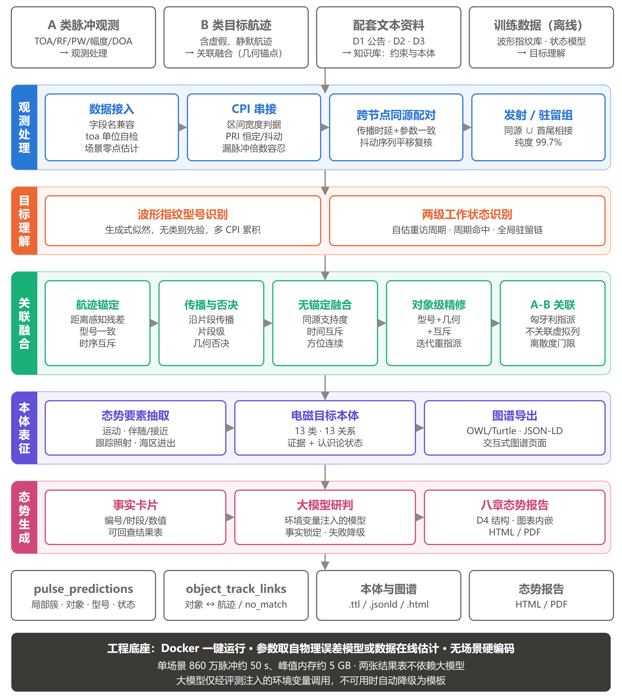
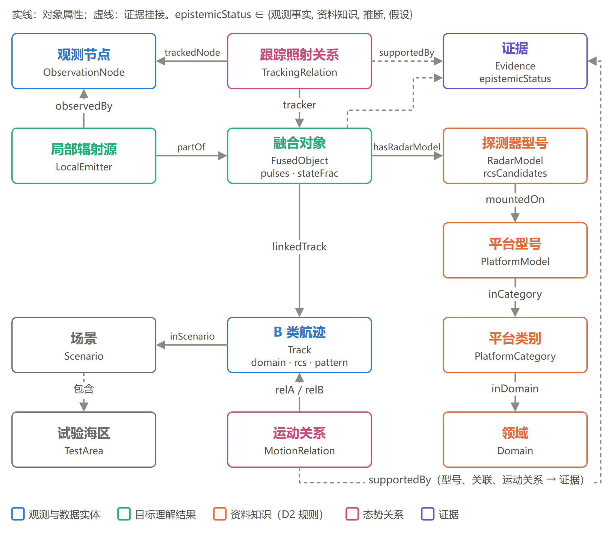
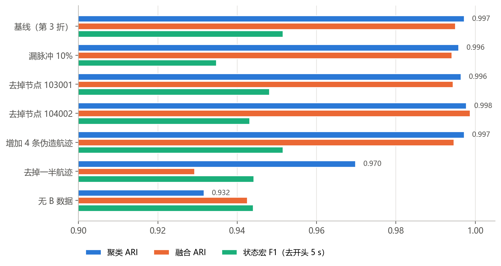

<!-- 技术方案报告正文（源文件）。由 tools/build_tech_report.py 套入官方模板生成正式版与盲审版。
     约定：# 一级标题（模板"01.GF报告一级标题"）；## 二级；### 三级；[表] 表题行后接管道表格；
     {14.5} 插图（宽度 cm）；**粗体**；以 "> " 开头的行为题注/说明小字。
     盲审要求：正文不得出现队名、成员、单位、A 榜分数等可识别身份的信息。 -->

# 摘要

多平台电子侦察中，各节点接收的脉冲高度交错且有漏收，同型号辐射源参数几乎相同，目标航迹又混有静默平台和虚假航迹，难以形成统一可信的目标认知。本方案构建"观测处理—目标理解—关联融合—本体表征—态势生成"五层电磁智能体：以区间宽度判据和漏脉冲倍数容忍串接相参处理间隔（CPI），依据"同一次发射在各节点只差传播时延"配对跨节点同源发射，抖动重频再做脉冲序列平移复核；用无类别先验的生成式波形指纹累积多 CPI 证据判定型号，以数据自估重访周期的精确命中特征与全局驻留链两级识别搜索/粗跟/精跟；以航迹为几何锚点，计入距离折算的航迹位置误差，结合型号一致与时序互斥迭代精修对象，并以带"不关联"虚拟列的匈牙利指派和残差离散度门限完成跨源关联；辐射源、平台、航迹、节点及其关系连同证据与认识论状态导出为 OWL/JSON-LD 图谱，大模型依据事实卡片撰写研判并经事实锁定校验。方案无场景硬编码，三折时间交叉验证中聚类与融合 ARI 均为 0.994、型号准确率 0.999、状态准确率 0.991、关联准确率 1.0，压力测试下保持稳定；Docker 镜像单场景约 50 s 输出结果表、图谱与态势报告。

关键词：电磁目标；脉冲去交错；跨平台融合；跨源关联；本体；智能体

# 一、需求分析与问题定义

## （一）赛题背景与任务解读

不同平台、不同设备获取的电磁数据格式不一、精度不同，同一目标的多源信息难以统一表征和对齐。赛题要求构建电磁智能体，从多源观测到电磁目标图谱与态势报告一键生成。输入为两类传感器数据：A 类传感器（多个本方观测节点）输出每个脉冲的到达时间（TOA）、三项隐藏参数（经分析分别对应载频 RF、脉宽 PW、幅度）、来波方向（DOA）与节点位置；B 类传感器输出目标航迹（位置、高度、散射等级），另有场景简报、型号手册、传感器说明等文本资料。

输出为两张结果表：pulse_predictions 要求每个脉冲给出节点内局部分组（local_cluster_id）、跨平台统一对象（object_id）、型号（target_class）和工作状态（target_state：搜索 0、粗跟踪 1、精跟踪 2）；object_track_links 给出对象与航迹的对应关系，一条航迹至多关联一个对象，不得以删除对象或脉冲表达"未关联"。机器评分覆盖聚类、类型、状态、跨平台融合、A-B 关联五个维度，占总分 80%；专家评分占 20%。B 榜由主办方在未公开场景上直接运行参赛代码包，因此方案必须对场景时长、节点数、航迹数等无硬编码，并能在评测环境中稳定、快速运行。

我们把任务分解为一条有明确接口的处理链：脉冲 → CPI（相参处理间隔，一部雷达连续发射的一组参数相同的脉冲）→ 跨节点"发射" → 局部辐射源与融合对象 → 型号与状态 → 对象—航迹关联 → 本体实例 → 态势报告。每一步的输出都可与真值或原始观测对照核查。

## （二）数据特性分析

[表] 表1 初赛 A 榜数据规模

| 数据 | 规模 | 时长 | 说明 |
|---|---|---|---|
| P1A_train A 类 | 15,869,054 个脉冲 | 500 s | 4 个观测节点，含目标、型号、状态真值 |
| P1A_train B 类 | 4,009 点 / 12 条航迹 | 500 s | 含 3 条无辐射航迹（虚假或静默） |
| P1A_test A 类 | 8,600,592 个脉冲 | 300 s | 无真值 |
| P1A_test B 类 | 3,313 点 / 16 条航迹 | 300 s | 型号字段全空 |

通过对训练集逐目标统计，得到以下对方案设计起决定作用的事实：

（1）**CPI 结构清晰但噪声有界。** 同一 CPI 内 RF 均匀误差约 ±2.5 MHz（大于资料所述 ±0.5 MHz）、PW ±0.1 μs、幅度 ±0.5 dB，DOA 误差空中节点 ±1.5°、海面节点 ±3°；非抖动型号 CPI 内重复周期（PRI）精确恒定，CPI 长度为 2 的整数次幂。同一雷达连续发射时，后一 CPI 首脉冲恰为前一 CPI 末脉冲加一个 PRI。

（2）**测试集存在随机漏脉冲。** 测试集约 2.9% 的脉冲随机缺失（与幅度无关），训练集几乎没有（0.02%）。若不处理，测试集 CPI 中位长度只有 17（训练集 64）。

（3）**同一次发射被多个节点同时接收。** 各节点 TOA 共用同一时基；同一发射在不同节点上 RF、PW、PRI 一致，TOA 只差传播时延（几十微秒），DOA 则各不相同。由于 RF 按 CPI 随机捷变，这一"同源"关系判别力极强。

（4）**同型号多实例普遍。** 训练集 11 个有辐射目标中，R01、R03、R05 各有两部；同型号雷达的参数档位与占比完全相同，只能依靠几何与时序区分。

（5）**B 类航迹含干扰。** 训练集 12 条航迹中 3 条没有对应辐射源（虚假或全程静默平台），同时有 2 个辐射源没有航迹；测试集还出现多对相距 145–390 m 的伴飞/伴航航迹。航迹位置噪声约 50–150 m。

（6）**工作状态是边扫边跟的交织结构。** 跟踪驻留按固定重访周期（训练、测试集均为 400 ms）插入搜索扫描；一段跟踪的前若干次驻留为粗跟、之后为精跟。粗跟与精跟驻留的脉冲数、PRI、PW、RF 分布完全相同，只能依靠驻留在跟踪段中的位置区分；粗跟仅占约 1.5% 的脉冲。

## （三）关键挑战

一是高密度交错与漏脉冲下的 CPI 提取：860 万脉冲、4 个节点、十余部雷达同时工作，漏脉冲使 PRI 序列断裂。

二是同型号辐射源的分离与跨平台融合：同型号参数不可区分，多部雷达在同一时刻以相同参数起始扫描，简单的"时间+参数"配对会把两部雷达误配为同一次发射。

三是跨源关联中的歧义：无航迹的辐射源可能与附近静默航迹方位重合；伴飞航迹在方位上几乎不可分；航迹位置误差在近距离时折算成显著的方位误差。

四是状态识别中的细粒度时序判别：粗跟/精跟无参数差异，跟踪段起点又与搜索中的检测驻留形式相同。

五是泛化与可信：B 榜场景未知，所有门限必须来自物理误差模型或数据自估计；本体和报告要区分观测事实、资料知识、推断与假设，结论能回查到结果表。

# 二、总体技术架构

## （一）系统框架

系统按赛题定义的电磁智能体能力划分为五层（图1）。各层之间以数据表为接口，任一层可单独替换或复用。

{14.6}

**观测处理层**完成数据接入（字段名兼容、TOA 单位自检、场景零点估计）、CPI 串接、跨节点同源配对，并把"同源发射 ∪ 节点内首尾相接"的连通分量组织为驻留组。**目标理解层**对每个 CPI 计算各型号的波形指纹似然，对每个脉冲判定工作状态。**关联融合层**以航迹为锚点形成对象，对无航迹部分做节点内串接与同源融合，再进行对象级迭代精修和 A-B 关联。**本体表征层**抽取态势要素、实例化电磁目标本体并导出图谱。**态势生成层**由事实卡片驱动大模型撰写研判段落，按 D4 模板生成八章报告。

五项机器评分对应的两张结果表全部由前三层的确定性算法产出，不依赖大模型。这样做有三点考虑：结果可复现、可逐项核查；评测网关限流 120 次/分钟，大规模脉冲级推理无法经由大模型完成；B 榜运行有时限，结果表的生成不能受网络与模型时延影响。

## （二）本体模型建立框架

本体采用"概念层（TBox）+ 场景实例层（ABox）"两层结构（图2），以 rdflib 构建并导出 Turtle、JSON-LD 两种格式和一个交互式图谱页面。

{14.6}

概念层包含 13 个类：场景、本方观测节点、局部辐射源、融合对象、探测器型号、平台型号、平台类别、领域、B 类航迹、跟踪照射关系、运动关系、证据、试验海区；以及 13 种对象属性，如 observedBy（局部辐射源被节点观测）、partOf（局部辐射源归并为融合对象）、hasRadarModel、mountedOn、inCategory、inDomain、linkedTrack、tracker/trackedNode、relA/relB、supportedBy。

本体构建遵循三条原则。第一，**知识来源分层**：型号—平台型号—类别—领域链条及散射等级候选来自型号手册中的【规则】，作为硬约束；运动模式等【倾向】只作软证据。第二，**证据显式化**：每个推断（型号判定、对象—航迹关联、跟踪照射关系）挂接证据节点，记录数值证据（如方位命中率、残差中位数、型号似然差）。第三，**认识论状态标注**：每条证据带 epistemicStatus 属性，取值为观测事实、资料知识、推断、假设四类，直接对应态势报告模板"区分事实、知识、推断与假设"的要求。P1A_test 场景实例化后共 1,420 个三元组。

## （三）智能体框架

智能体采用"工具链感知 + 知识约束 + 事实驱动生成"的结构：

（1）**感知工具链**：观测处理、目标理解、关联融合各模块封装为独立函数，输入输出均为表格，按流水线调度；运行中记录各阶段规模与耗时，便于诊断。

（2）**领域知识库**：从配套资料中抽取型号—平台映射、领域、散射等级、扇区几何与试验海区公告，存为结构化配置；在锚定、关联和本体构建中作为约束和先验知识使用。

（3）**事实卡片**：态势要素抽取模块把结果表与原始观测整理为带编号的事实（对象、航迹、节点、时段、数值），本体与报告共用这一份事实，保证二者一致。

（4）**大模型研判**：仅通过评测环境注入的 LLM_BASE_URL、LLM_API_KEY、LLM_MODEL 等环境变量调用主办方提供的模型，代码中不出现模型名、地址或密钥。系统提示要求模型只依据给定事实作答、区分事实与推断。输出经"事实锁定"校验：文中出现的对象号、航迹号、节点号必须存在于事实卡片中，否则携带错误提示重试；仍失败则降级为规则模板文本。调用支持 JSON 输出模式开关、思考链开关与 429 限流退避。

（5）**降级与容错**：未注入大模型环境变量、调用失败或报告生成异常时，均不影响两张结果表的输出。

## （四）核心数据流示例

图3 给出 P1A_test 场景实际运行时各环节的数据规模。860 万个脉冲被串接为 13.4 万个 CPI，再组织为 7.99 万次跨节点发射和 4.87 万个驻留组；82.9% 的脉冲直接锚定到航迹，最终形成 12 个对象、47 个局部簇，其中 10 个对象关联到航迹。

{14.6}

## （五）工程实现

[表] 表2 主要模块与职责

| 模块 | 职责 |
|---|---|
| io / geo | 数据读取与字段兼容、格式自检与写出；WGS84 方位、距离计算 |
| cpi | 节点内 CPI 串接（含漏脉冲容忍、抖动 PRI） |
| fingerprint | 生成式波形指纹：训练与逐 CPI 型号似然 |
| tracking | 节点内片段串接、跨节点同源配对与抖动序列复核、无锚定融合与对象合并 |
| anchor / refine | 航迹锚定、标签传播与几何否决、对象级迭代精修 |
| recognize | 两级工作状态识别（周期命中、驻留链特征） |
| association | A-B 跨源关联 |
| situation / ontology / report / agent | 态势要素、本体图谱、态势报告、大模型研判 |
| training / evaluate | 训练流程（与推理共用代码）、本地多指标评分 |

代码包按官方模板组织（Dockerfile、run.sh、requirements.txt、README.md、src、config、output），基础镜像为 python:3.11-slim，主要依赖 numpy、pandas、scipy、scikit-learn、numba、rdflib、requests。评测服务以"--task all --test --out-dir /output"调用入口，程序从 /input 读取数据，输出文件按"[场景编号]_[数据版本]_*.csv"命名并在写出前自检格式。模型文件（波形指纹库与状态模型）随代码包提供，推理时不需要网络。

# 三、关键技术

## （一）漏脉冲鲁棒的 CPI 串接

在每个节点的脉冲流中，以贪心多链方式把脉冲串接为 CPI。参数门限采用"区间宽度"判据：均匀有界噪声下，同一 CPI 内所有脉冲的参数极差不超过噪声全宽，因此新脉冲并入的条件是并入后 RF、PW、幅度、DOA 的极差仍在全宽以内（RF 6 MHz、PW 0.25 μs、幅度 1.3 dB，DOA 按节点类型取误差全宽加余量），这比"与均值之差"判据更紧且不受链长影响。时间上要求到达间隔等于 PRI 的整数倍（k ≤ 6），从而跨过漏收的脉冲；若链首间隔恰为倍数，则自动修正 PRI 估计。对于 PRI 抖动型号，以相对窗口（±8%）跟踪。训练时随机丢弃 3% 的脉冲做数据增强。处理后测试集 CPI 中位长度从 17 恢复到 62，与训练集相当。

为防止异常输入，程序在读入后自检 TOA 单位：若相邻到达间隔中位数大于 5000，判为纳秒并换算；合并、并入等步骤设有对象数上限和向量化兜底，避免退化为平方复杂度。

## （二）跨节点同源发射配对与驻留组

**同源配对。** 两个节点上的 CPI 若起止时刻相差不超过最大传播时延（基线/光速加截断余量，400 μs），且 RF、PW、PRI 一致，判为同一次发射。由于 RF 按 CPI 随机捷变，偶然满足条件的概率极低，训练集上同源配对精度为 99.4%。

**抖动序列复核。** PRI 抖动型号（如 R05/R06）的两部同型雷达同时发射时，仅凭起止时间和参数会被误配。我们利用"同一次发射的抖动序列在两节点上只差一个固定时延"这一物理事实：取两个 CPI 首尾各 3 个脉冲的两两时间差作为候选平移量，在最佳平移下要求 ±2 μs 内命中的脉冲比例不低于 60%。训练集上真配对 85% 的首尾时延差小于 2 μs，误配通过率为 0；测试集否决 6.4% 的抖动配对。若否决比例超过一半（说明到达时间噪声超出假设），自动放弃复核，保证泛化安全。

**发射构建。** 多个节点的配对按连通分量合并为"发射"，约束每次发射在每个节点至多一个 CPI。合并顺序先按两个节点内片段之间的配对支持数（按 log2 分档）从大到小，再按时间差从小到大，使偶发的交叉配对让位给大量一致的同源配对。

**驻留组。** 同一雷达连续发射的 CPI 首尾精确相接（后一 CPI 首脉冲 = 前一 CPI 末脉冲 + PRI，允许漏脉冲倍数）。把"跨节点同源"与"节点内首尾相接"两类边合并取连通分量，得到驻留组，训练集上纯度为 99.7%。驻留组是后续锚定、精修的基本单元。

## （三）生成式波形指纹型号识别

型号手册指出同型号波形定义相同、同类两型号参数部分重叠，单个 CPI 往往不足以区分。我们为每个型号学习 RF、PW、PRI 的核密度分布及抖动标志，构成生成式朴素贝叶斯"波形指纹"，对每个 CPI 计算各型号的对数似然。对象级型号取各 CPI 对数似然之和的最大者：落在重叠区的 CPI 各型号似然接近，自然被降权；单 CPI 似然差设上限，防止个别异常 CPI 主导结果。

选用生成式模型而非判别式分类器，是因为实验发现判别式模型会把训练场景中各型号的数量比例当作先验，在 R03/R04 等重叠区系统性地偏向训练集中更常见的型号；换场景（B 榜）后这种偏差不可控。生成式似然不含类别先验，配合对象级证据累积，型号准确率由基线的 0.975 提升至 0.995 以上（当前版本 0.999）。

## （四）航迹锚定与距离感知方位残差

B 类航迹提供了辐射源平台的几何位置。对每个 CPI，把航迹插值到 CPI 时刻，计算"观测节点 → 航迹位置"的方位，与该 CPI 的 DOA 之差即方位残差。训练集上真实对应的残差中位数仅 0.12°–0.26°，因此航迹可作为聚类的几何锚点。

**距离感知残差。** 航迹位置误差约 100 m，当节点与目标距离较近时，折算出的方位误差不可忽略：空中节点距目标 10 km 以内时残差中位数为 0.50°，20–30 km 时为 0.14°，30–50 km 时为 0.11°。为此按误差传播把残差尺度改为

σ_eff = √( σ_doa² + (σ_pos / r)² )

其中 σ_doa 为节点测向误差（空中 0.3°、海面 0.55°，训练集实测），σ_pos 为航迹位置误差（100 m），r 为节点到航迹点的距离（换算为角度）。残差再按 σ_doa/σ_eff 缩放回测向尺度，使下游门限含义不变。σ_pos 在 50–250 m 范围内效果平稳（三折 ARI 0.990–0.992），不加距离修正时为 0.990。

**锚定指派。** 以驻留组为单元，综合多节点联合残差、型号一致性（一个平台只挂一部雷达，航迹型号由残差最小的高把握单元投票决定）、领域与散射等级规则、时序互斥（同一辐射源同一时刻只发射一个 CPI）计算代价，最优与次优航迹的代价差足够大时才锚定。随后执行两步修正：标签沿节点内片段向相邻未锚定的 CPI 传播（要求时间近、方位连续、型号相容）；若某节点内片段在大部分时间都不符合所挂航迹的方位，则撤销锚定（片段级几何否决），防止无航迹辐射源因偶然方位重合被挂到他人航迹上。

## （五）无航迹融合与对象级迭代精修

未能锚定的 CPI（无航迹辐射源或歧义部分）在各节点内按时间与方位连续性串接为片段，再以同源配对数为权重、在"同节点片段时间不重叠"约束下贪心合并为对象。对象之间若型号相容、全局发射时序无冲突且同节点方位衔接，则继续合并；脉冲数很少的对象并入方位最连续、型号相容的大对象。

对象成形后，对象级型号和航迹已经可靠，可反过来纠正单元级错误。精修以驻留组为单元，对每个候选对象计算"型号似然 + 几何项（有航迹时为方位残差，无航迹时为同节点方位连续性；单 CPI 封顶）− 时序冲突惩罚"，得分增益超过门限才改归，迭代 2 轮。三项经验证得出的约束保证了精修的稳健：

（1）型号门限按单元内 CPI 的加权平均似然差计算（4 nats）：跨频段的 CPI 每个约差 13.8 nats，仍被拦截；同频段参数重叠的型号（如 R07/R08）不再因多个 CPI 累加而被一票否决，交给几何与互斥判定。

（2）直接锚定的单元锁定不动，只改动传播或兜底得来的单元。

（3）没有航迹时只依靠方位连续性，证据不足，验证显示精修反而有害，此时跳过精修。

## （六）A-B 跨源关联

对每个对象与每条航迹计算方位命中率、残差中位数和残差离散度，在领域、散射等级规则约束下构造代价矩阵。为避免匈牙利算法"为凑满指派而牺牲正确关联"，每个对象增加一个代价固定的"不关联"虚拟列；锚定结果作为先验，对象过半脉冲锚定于同一航迹时优先该航迹。

**残差离散度门限。** 无航迹辐射源有时与 1–2 km 外的静默航迹方位命中率高达 0.9997，命中率无法区分。我们注意到：正确关联时各节点带符号残差的离差很小（CPI 级方位是多脉冲平均），而近旁另一目标的方位随时间变化形状不同，离差增大。定义离散度为各节点残差中位绝对偏差（MAD）与该节点脉冲级测向误差之比，按 CPI 数加权；超过 0.35 判为不可行。三折中正确关联最大 0.214，错误关联为 0.46–0.63，测试集 10 个关联最大 0.198。

**伴随航迹去重。** 伴飞/伴航编队中静默平台的航迹也可能获得型号。规定一个辐射源只对应一条航迹：同型号、支撑单元重合超过一半且距离中位数小于 600 m 的两条航迹，只保留残差更小者。

## （七）两级工作状态识别

**第一级：跟踪/搜索。** 跟踪驻留严格按重访周期 P 重复（相位抖动小于 1 ms），而搜索不具有这种周期性。P 不写死，由数据估计：对每个（对象，节点）统计相邻短脉宽驻留的间隔直方图，按对象内占比求和取峰值。经 3 折 × 训练/测试 × 逐个去节点共 30 种组合检验，均估得 400 ms，峰值得分为次高峰的 2.5–3 倍。在此基础上构造周期命中特征：同对象短脉宽 CPI 在 t ± mP（m = 1…5）处 ±1 ms 的精确命中数、前后连续命中数、±0.1P 宽松命中、同节点命中、±P/2 命中，并辅以相对脉宽（训练集跟踪驻留均使用该型号最短脉宽）、幅度抬升等特征，以梯度提升树判别；同一发射在各节点的概率取平均，保证多节点一致。

**第二级：粗跟/精跟。** 粗跟是一段跟踪的前若干次驻留，关键是可靠地把跟踪驻留连成"链"并确定链内位置。我们先把同一对象起始相差 1.5 ms 以内的跟踪 CPI 合并为一次驻留（不同节点接收同一驻留），再对所有候选（前驱，后继）对按"相位偏差 + 漏收惩罚 + 节点变化惩罚"全局升序贪心配对：每个驻留至多一个前驱、一个后继，允许 ±0.2P 的调度相位跳变和至多 2 次漏收。由此得到链内序号、链内时间、距链尾时间等特征，再由第二级梯度提升树判定粗跟/精跟。全局配对避免了交错跟踪或新跟踪插入时把两条链串成一条。

**训练伪影屏蔽。** 时间分折训练时，数据中段的截断处会把进行中的精跟段误当作新段起点。训练时屏蔽这类位置之后 6 s 内的第二级样本（完整场景训练时该操作为空），评估时另报"去掉窗口开头 5 s"的指标。

## （八）本体表征与态势报告生成

态势要素抽取模块在结果表基础上计算：观测节点与航迹的运动方式（以滑动窗口线性拟合抑制约 65 m 的位置噪声）、航迹两两之间的伴随/编队与近距接近、试验海区进出、跟踪照射关系（跟踪驻留中幅度显著高于常态的节点即被照射节点）、对象型号把握度（最优与次优型号平均每 CPI 似然差）。这些事实同时写入本体实例层和报告。

报告按 D4 模板八章组织：观测概览、对象清单、类别与工作状态、平台观测关系、A-B 关联、活动与态势研判、冲突与竞争解释、无法确认的部分。每条结论注明 object_id/track_id 等证据并标注观测事实/资料知识/推断/假设，内嵌态势地图和状态热图；对上游结果的疑点如实说明，不为叙事通顺修改事实。

## （九）创新点小结

（1）**物理约束驱动的同源判定**：以"同一次发射在各节点只差传播时延"为核心，配合抖动序列平移复核，把跨平台融合从统计相似性问题转化为可验证的物理一致性问题。

（2）**航迹锚定聚类**：把 B 类航迹作为几何锚点直接参与脉冲聚类，而不仅在最后做关联；引入距离感知残差，消除近距离下航迹位置误差造成的误判。

（3）**无先验的生成式波形指纹**：避免判别式模型吸收训练场景类别比例，适应 B 榜未知场景。

（4）**基于重访周期的状态识别**：数据自估重访周期、全局驻留链，把粗跟/精跟这类无参数差异的状态转化为可学习的时序位置特征。

（5）**证据化本体与事实锁定生成**：本体中每个推断带证据与认识论状态，大模型只依据事实卡片写作并经编号校验，保证报告可核查。

# 四、实验结果

## （一）实验环境

开发与验证在一台 24 线程 CPU、128 GB 内存的工作站上进行（未使用 GPU）。提交前在 WSL2 Ubuntu 24.04 中按评测流程验证：解压代码包 → docker build（python:3.11-slim）→ 断网（--network none）、只读挂载 /input 运行 → 检查 /output。容器内输出与本机输出逐字节一致（MD5 相同）。

## （二）评测方法

官方评分公式未公布，评分器"依据对象成员关系"评价，因此本地采用与编号无关的多指标并行评估：聚类用各节点调整兰德指数（ARI）均值及成对 F1；型号、状态用按脉冲加权的准确率与宏 F1；融合用对象层 ARI；关联用对象级与航迹级准确率（含 no_match）。

验证方案为训练集三折时间交叉验证：把 500 s 训练数据等分为三段，每次用其余两段训练，把测试段截为独立场景（时间重新从零开始）运行完整流程，并模拟 3% 漏脉冲以贴近测试集。第 2、3 折的窗口不从真实场景起点开始，开头处进行中的跟踪段被截断，另报去掉窗口开头 5 s 的状态宏 F1。压力测试在第 3 折模型与测试段上进行。

## （三）主要结果

[表] 表3 三折时间交叉验证结果（v8）

| 指标 | 第1折 | 第2折 | 第3折 | 均值 |
|---|---|---|---|---|
| 聚类 ARI | 0.991 | 0.994 | 0.997 | 0.994 |
| 聚类成对 F1 | 0.993 | 0.995 | 0.998 | 0.995 |
| 型号准确率 | 1.000 | 0.999 | 0.999 | 0.999 |
| 状态准确率 | 0.995 | 0.990 | 0.987 | 0.991 |
| 状态宏 F1（去开头 5 s） | 0.957 | 0.945 | 0.952 | 0.951 |
| 融合 ARI | 0.990 | 0.996 | 0.995 | 0.994 |
| 关联准确率（对象/航迹） | 1.000 | 1.000 | 1.000 | 1.000 |
| 对象数（真值 11） | 11 | 11 | 11 | — |
| 单折运行时间 | 41 s | 37 s | 31 s | — |

三折对象数均与真值一致，所有对象—航迹关联（含无航迹对象的 no_match 和无辐射航迹的空关联）全部正确。

## （四）方案迭代与消融

表4 汇总了方案从基线到当前版本的演进。v1、v2 为单次切分（前 300 s 训练、后 200 s 评估）结果，v4 起统一为三折交叉验证均值。

[表] 表4 方案迭代过程

| 版本 | 主要改进 | 聚类 ARI | 型号准确率 | 状态宏 F1 | 融合 ARI | 关联准确率 |
|---|---|---|---|---|---|---|
| v1 | 频段/参数预分选 + CPI + 节点内串接 | 0.897 | 0.975 | 0.755 | 0.807 | 0.55 |
| v2 | 航迹锚定、波形指纹、驻留组 | 0.987 | 0.995 | 0.897 | 0.988 | 1.00 |
| v4 | 泛化修复（判型、虚拟列、片段否决） | 0.980 | 0.998 | 0.837 | 0.977 | 0.970 |
| v5 | 对象级迭代精修 | 0.984 | 0.997 | 0.881* | 0.984 | 0.970 |
| v6 | 残差离散度门限、驻留链特征 | 0.984 | 0.997 | 0.894* | 0.984 | 1.000 |
| v7 | 周期精确命中、全局驻留链 | 0.984 | 0.997 | 0.933* | 0.984 | 1.000 |
| v8 | 抖动序列复核、距离感知残差等 | 0.994 | 0.999 | 0.951* | 0.994 | 1.000 |

> 注：带 * 者为去掉窗口开头 5 s 的口径；v2→v4 指标下降是因为改用更严格的三折交叉验证，暴露了单次切分未发现的泛化问题。

表5 给出 v8 各项改进对对象形成的逐步贡献（三折聚类 ARI，模型相同）。

[表] 表5 v8 改进的逐步消融

| 配置 | 第1折 | 第2折 | 第3折 | 均值 |
|---|---|---|---|---|
| v7 基线 | 0.9811 | 0.9877 | 0.9826 | 0.9838 |
| + 抖动序列复核 | 0.9821 | 0.9902 | 0.9860 | 0.9861 |
| + 平均型号门限 | 0.9840 | 0.9930 | 0.9923 | 0.9898 |
| + 距离感知残差 | 0.9890 | 0.9938 | 0.9940 | 0.9923 |
| + 片段支持度配对 | 0.9898 | 0.9964 | 0.9950 | 0.9937 |

状态识别方面，用周期精确命中特征替换写死 200 ms 的旧特征并加入全局驻留链后，状态宏 F1（去开头 5 s）由 0.894 提高到 0.933；若第一级使用真值，宏 F1 可达 0.96–0.98，说明剩余误差主要在第二级。

## （五）鲁棒性验证

为检验 B 榜未知场景下的稳健性，在第 3 折上进行六类压力测试（图4）：测试集漏脉冲提高到 10%、去掉一个空中或海面观测节点、增加 4 条伪造航迹（距真实目标 300 m 或 3 km）、随机去掉一半航迹，以及完全没有 B 类数据。

{14}

漏脉冲、去节点、伪造航迹对各项指标几乎没有影响（聚类 ARI 0.996–0.998），所有压力条件下格式自检均通过、对象—航迹关联均正确。去掉一半航迹时聚类 ARI 为 0.970，完全无 B 类数据时为 0.932（此时不做精修，依靠节点内串接与同源融合兜底），状态宏 F1 始终保持在 0.935–0.952。此外，在原理理解数据（频段、波形与初赛不同）上运行（v4 版本测得），聚类 ARI 0.958、融合 ARI 0.94、对象数 4/4，说明聚类与融合不依赖特定波形库。

## （六）测试集运行与态势报告效果

P1A_test 场景在容器内单场景运行约 50 s，峰值内存约 5 GB，输出 12 个对象（47 个局部簇），10 个对象关联到航迹，2 个对象判为 no_match；6 条航迹未关联辐射源，其中多条与已关联航迹保持持续伴随或编队关系，推断为静默平台。状态预测分布为搜索 77.9%、粗跟 1.8%、精跟 20.3%，与训练集真值分布（77.1%/1.5%/21.5%）接近，测试集重访周期估计为 400 ms。

图5 为系统生成的态势地图：黑色为本方观测节点轨迹，彩色为已关联对象的航迹（标注航迹号、对象号与型号），灰色为未关联航迹，虚线框为试验海区公告范围。报告据此给出各平台的运动方式、进出海区情况、跟踪照射关系（共识别 28 组对象—节点跟踪照射关系）以及编队/伴随研判，每项结论均可回查结果表。

{12}

## （七）误差分析

聚类剩余误差主要有两类：一是某空中雷达在约 4 s 内只被一个海面节点收到，其方位恰与邻近同型号飞机的航迹重合（残差 0.02°，而对其自身航迹为 −1.5°），单节点几何信息无法分辨；二是 R03 两部、R07/R08 伴航编队之间仍有每折数千脉冲的互混。

状态识别的主要误差是"粗跟被判为精跟"。分析训练集真值发现，178 个新跟踪段中有 78 个是精跟在同一时隙直接回落为粗跟，回落前没有检测驻留；回落在多部雷达之间同时发生，但与精跟持续次数、RF、PRI、被跟踪节点、平台机动均无可观测关联，从脉冲数据基本无法预测，可视为当前数据下的识别上限。其次是长链的第一个驻留（检测驻留）与第一个粗跟驻留形式相同，二者难以区分。

# 五、总结与展望

## （一）核心贡献与价值

[表] 表6 痛点与方案映射

| 痛点 | 方案 | 效果 |
|---|---|---|
| 高密度交错、漏脉冲 | 区间宽度判据 + PRI 整数倍容忍的 CPI 串接 | 测试集 CPI 中位长度 17 → 62 |
| 跨平台同源难判定 | 传播时延约束 + 抖动序列平移复核 + 驻留组 | 同源配对精度 99.4%，驻留组纯度 99.7% |
| 同型号多实例分离 | 航迹锚定 + 距离感知残差 + 对象级精修 | 聚类/融合 ARI 0.994 |
| 型号重叠、场景先验偏差 | 无先验生成式波形指纹，多 CPI 证据累积 | 型号准确率 0.999 |
| 静默/伴随航迹干扰 | 不关联虚拟列 + 残差离散度门限 + 伴随去重 | 关联准确率 1.0 |
| 粗跟/精跟无参数差异 | 自估重访周期 + 全局驻留链 + 两级分类 | 状态准确率 0.991，宏 F1 0.951 |
| 结论可信、可核查 | 证据化本体 + 事实卡片 + 事实锁定生成 | 报告结论可回查结果表 |

方案的核心价值在于以物理约束和数据自估计替代人工调参：所有门限来自传感器误差模型或训练数据统计，重访周期、场景零点等由数据在线估计，因此在节点缺失、漏脉冲增加、航迹缺失或含伪造航迹时仍保持稳定，适合直接部署到新场景。

## （二）当前局限

（1）**单节点几何歧义**：只有一个节点收到、且方位与他人航迹重合的片段无法纠正，需要更多观测或更长时间的连续性推理。

（2）**无航迹条件下性能下降**：完全无 B 类数据时聚类 ARI 降到 0.93，此时同频段同型号辐射源只能依靠方位连续性区分。

（3）**状态识别存在数据上限**：精跟直接回落为粗跟的事件不可预测，粗跟类的 F1 难以继续提升。

（4）**领域知识的获取方式**：型号、平台、海区等领域知识目前由人工从配套文本资料中整理为结构化配置，新场景的文本资料尚需人工更新。

（5）**波形库覆盖**：型号识别依赖训练数据中的波形指纹，未见过的型号无法正确命名（聚类与融合不受影响）。

## （三）未来迭代规划

短期：一是在无航迹条件下引入多节点交叉定位轨迹作为"伪航迹"，复用锚定与精修框架；二是对单节点歧义片段输出"竞争解释"，在报告中列出备选归属与证据；三是利用大模型从场景简报、型号手册等文本中自动抽取型号—平台映射、试验海区公告等知识，并与已有知识库做一致性校验，减少人工整理。

长期：将本体扩展为跨场景的电磁目标知识库，累积各平台的波形指纹、活动规律和关系历史；把各处理模块封装为标准工具接口，供大模型按分析问题动态调用（如"某平台何时开始跟踪我方节点"），实现交互式态势问答；同时引入在线增量处理，支持实时脉冲流。本方案的模块化接口与证据化本体可直接迁移到其他多源侦察融合任务，如雷达与 AIS/ADS-B 等合作目标数据的关联。
