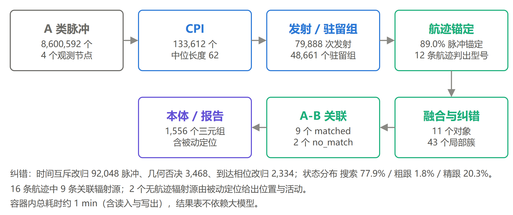
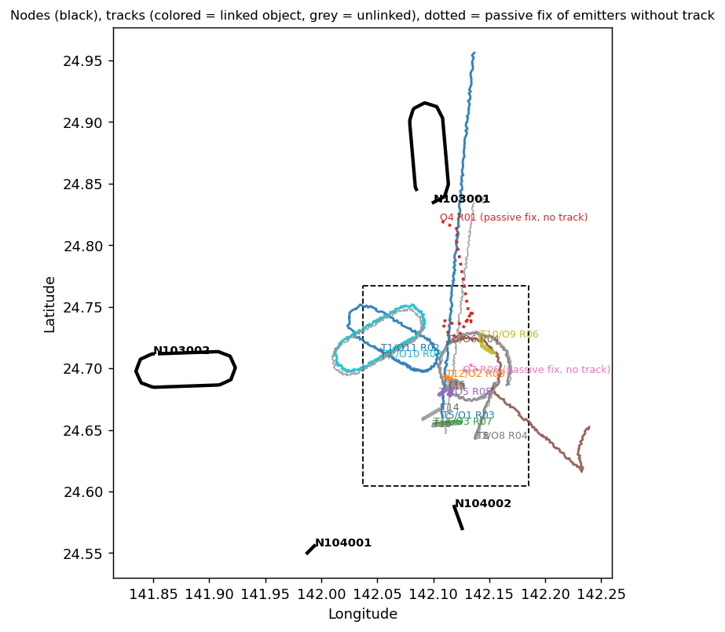

<!-- 技术方案报告正文（源文件）。由 tools/build_tech_report.py 套入官方模板生成正式版与盲审版。
     约定：# 一级标题（模板"01.GF报告一级标题"）；## 二级；### 三级；[表] 表题行后接管道表格；
     {14.5} 插图（宽度 cm）；**粗体**；以 "> " 开头的行为题注/说明小字。
     盲审要求：正文不得出现队名、成员、单位、A 榜分数等可识别身份的信息。 -->

# 摘要

多平台电子侦察中，各节点接收的脉冲高度交错且有漏收，同型号辐射源参数几乎相同，目标航迹又混有静默平台、伴飞编队和缺失，难以形成统一可信的目标认知。本方案构建"观测处理—目标理解—关联融合—本体表征—态势生成"五层电磁智能体。观测处理以区间宽度判据和漏脉冲倍数容忍串接相参处理间隔（CPI），依据"同一次发射在各节点只差传播时延"配对跨节点同源发射；目标理解用无类别先验的生成式波形指纹判定型号，以数据自估重访周期与全局驻留链两级识别搜索/粗跟/精跟；关联融合以航迹为几何锚点形成对象，并依次用节点内时间互斥、跨节点到达时间差、几何否决和**到达时刻相位测距**纠正同型号雷达间的错归——我们发现各辐射源驻留起点的发射时刻落在公共 64 μs 时间格上，到达时刻对 64 μs 取模即为节点—辐射源距离，单个节点即可测距。在此基础上实现**被动定位**：多站测向交会与相位测距联合估计辐射源轨迹，训练数据上水平误差中位 64–190 m，与航迹自身误差同量级，为无航迹辐射源给出位置与活动、为每条关联提供独立佐证，并在航迹缺失时作为伪航迹参与聚类。辐射源、平台、航迹、节点及其关系连同证据与认识论状态导出为 OWL/JSON-LD 图谱，大模型依据事实卡片撰写研判并经事实锁定校验。方案无场景硬编码，测向误差、重访周期、时间偏移等由数据在线估计，并设有分级降级运行保证任何输入下都能输出合法结果。三折时间交叉验证中聚类逐簇 F1 0.999、融合 ARI 0.999、型号准确率 0.9997、状态宏 F1 0.959、关联准确率 1.0；在去节点、航迹缺失、伪造与伴飞航迹、测向误差增大、时间偏移、杂散脉冲等 13 类 54 组压力测试下保持稳定；Docker 镜像单场景约 1 min 输出结果表。

关键词：电磁目标；脉冲去交错；跨平台融合；到达时刻测距；被动定位；本体；智能体

# 一、需求分析与问题定义

## （一）赛题背景与任务解读

不同平台、不同设备获取的电磁数据格式不一、精度不同，同一目标的多源信息难以统一表征和对齐。赛题要求构建电磁智能体，从多源观测到电磁目标图谱与态势报告一键生成。输入为两类传感器数据：A 类传感器（多个本方观测节点）输出每个脉冲的到达时间（TOA）、三项隐藏参数（经分析分别对应载频 RF、脉宽 PW、幅度）、来波方向（DOA）与节点位置；B 类传感器输出目标航迹（位置、高度、散射等级），另有场景简报、型号手册、传感器说明等文本资料。

输出为两张结果表：pulse_predictions 要求每个脉冲给出节点内局部分组（local_cluster_id）、跨平台统一对象（object_id）、型号（target_class）和工作状态（target_state：搜索 0、粗跟踪 1、精跟踪 2）；object_track_links 给出对象与航迹的对应关系，一条航迹至多关联一个对象，不得以删除对象或脉冲表达"未关联"。机器评分覆盖聚类、类型、状态、跨平台融合、A-B 关联五个维度，占总分 80%；专家评分占 20%。B 榜由主办方在未公开场景上直接运行参赛代码包，因此方案必须对场景时长、节点数、航迹数等无硬编码，并能在评测环境中稳定、快速运行，任何异常都不能导致无输出。

我们把任务分解为一条有明确接口的处理链：脉冲 → CPI（相参处理间隔，一部雷达连续发射的一组参数相同的脉冲）→ 跨节点"发射" → 局部辐射源与融合对象 → 型号与状态 → 对象—航迹关联 → 本体实例 → 态势报告。每一步的输出都可与真值或原始观测对照核查。

## （二）数据特性分析

[表] 表1 初赛 A 榜数据规模

| 数据 | 规模 | 时长 | 说明 |
|---|---|---|---|
| P1A_train A 类 | 15,869,054 个脉冲 | 500 s | 4 个观测节点，含目标、型号、状态真值 |
| P1A_train B 类 | 4,009 点 / 12 条航迹 | 500 s | 含 3 条无辐射航迹（虚假或静默） |
| P1A_test A 类 | 8,600,592 个脉冲 | 300 s | 无真值 |
| P1A_test B 类 | 3,313 点 / 16 条航迹 | 300 s | 型号字段全空 |

通过对训练集逐目标统计，得到以下对方案设计起决定作用的事实：

（1）**CPI 结构清晰但噪声有界。** 同一 CPI 内 RF 均匀误差约 ±2.5 MHz（大于资料所述 ±0.5 MHz）、PW ±0.1 μs、幅度 ±0.5 dB；脉冲级 DOA 误差严格为给定半宽的均匀分布（空中节点 ±1.5°、海面节点 ±3°）。非抖动型号 CPI 内重复周期（PRI）精确恒定，CPI 长度为 2 的整数次幂；同一雷达连续发射时，后一 CPI 首脉冲恰为前一 CPI 末脉冲加一个 PRI。

（2）**测试集存在随机漏脉冲。** 测试集约 2.9% 的脉冲随机缺失（与幅度无关），训练集几乎没有（0.02%）。若不处理，测试集 CPI 中位长度只有 17（训练集 64）。

（3）**同一次发射常被多个节点同时接收。** 各节点 TOA 共用同一时基；同一发射在不同节点上 RF、PW、PRI 一致，TOA 只差传播时延（几十微秒），DOA 则各不相同。由于 RF 按 CPI 随机捷变，这一"同源"关系判别力极强。但也有雷达按节点轮流照射（如 R01 每段约 25 ms 依次指向各节点），同一串脉冲从不被两个节点同时收到，跨节点时差无从测量。

（4）**驻留起点落在公共 64 μs 时间格上。** 同一辐射源在同一节点上相邻驻留的起点间隔都是 2 的幂次组合；对有航迹目标，用平滑航迹算出节点—目标距离 r，驻留首脉冲到达时刻 t₀ 满足 (t₀ − r/c) mod 64 μs ≈ 0（三折各目标各节点常数项 −0.5～0.75 μs，中位偏差 0.03–0.5 μs，即 10–150 m）。换言之，发射时刻落在与到达时间同一基准的 64 μs 格点上，**首脉冲到达时刻本身就是单节点测距**；而对其他航迹，相位残差在 [0, 32] μs 上近似均匀，落入 0.6 μs 的概率仅约 2%。

（5）**同型号多实例普遍。** 训练集 11 个有辐射目标中，R01、R03、R05 各有两部；同型号雷达的参数档位与占比完全相同，只能依靠几何与时序区分。

（6）**B 类航迹含干扰。** 训练集 12 条航迹中 3 条没有对应辐射源（虚假或全程静默平台），同时有 2 个辐射源没有航迹；测试集还出现多对相距 145–390 m 的伴飞/伴航航迹。航迹位置噪声约 50–150 m。

（7）**工作状态是边扫边跟的交织结构。** 跟踪驻留按固定重访周期（训练、测试集均为 400 ms）插入搜索扫描；一段跟踪的前若干次驻留为粗跟、之后为精跟。粗跟与精跟驻留的脉冲数、PRI、PW、RF 分布完全相同，只能依靠驻留在跟踪段中的位置区分；粗跟仅占约 1.5% 的脉冲。

## （三）关键挑战

一是高密度交错与漏脉冲下的 CPI 提取：860 万脉冲、4 个节点、十余部雷达同时工作，漏脉冲使 PRI 序列断裂。

二是同型号辐射源的分离与跨平台融合：同型号参数不可区分；多部雷达在同一时刻以相同参数起始扫描，简单的"时间+参数"配对会把两部雷达误配为同一次发射；分时照射的雷达又没有跨节点时差可用。

三是跨源关联中的歧义：无航迹的辐射源可能与附近静默航迹方位重合；伴飞航迹在方位上几乎不可分；航迹位置误差在近距离时折算成显著的方位误差。

四是状态识别中的细粒度时序判别：粗跟/精跟无参数差异，跟踪段起点又与搜索中的检测驻留形式相同。

五是泛化与可信：B 榜场景未知，可能出现航迹缺失、节点缺失、测向误差变化、时间不同步、数据异常；所有门限必须来自物理误差模型或数据自估计，程序在任何输入下都必须输出合法结果；本体和报告要区分观测事实、资料知识、推断与假设，结论能回查到结果表。

# 二、总体技术架构

## （一）系统框架

系统按赛题定义的电磁智能体能力划分为五层（图1）。各层之间以数据表为接口，任一层可单独替换或复用。

{14.6}

**观测处理层**完成数据接入（字段名兼容、TOA 单位自检、缺失值清洗、场景零点估计、测向误差自校准）、CPI 串接、跨节点同源配对，并把"同源发射 ∪ 节点内首尾相接"的连通分量组织为驻留组。**目标理解层**对每个 CPI 计算各型号的波形指纹似然，对每个脉冲判定工作状态。**关联融合层**以航迹为锚点形成对象，对无航迹部分做节点内串接（航迹缺失时辅以到达相位延续）与同源融合，再依次进行对象级迭代精修、节点内时间互斥重分配、几何否决与到达相位改归，最后完成 A-B 关联。**本体表征层**抽取态势要素（含被动定位）、实例化电磁目标本体并导出图谱。**态势生成层**由事实卡片驱动大模型撰写研判段落，按 D4 模板生成八章报告。

五项机器评分对应的两张结果表全部由前三层的确定性算法产出，不依赖大模型。这样做有三点考虑：结果可复现、可逐项核查；评测网关限流 120 次/分钟，大规模脉冲级推理无法经由大模型完成；B 榜运行有时限，结果表的生成不能受网络与模型时延影响。

## （二）本体模型建立框架

本体采用"概念层（TBox）+ 场景实例层（ABox）"两层结构（图2），以 rdflib 构建并导出 Turtle、JSON-LD 两种格式和一个交互式图谱页面。

{14.6}

概念层包含 14 个类：场景、本方观测节点、局部辐射源、融合对象、探测器型号、平台型号、平台类别、领域、B 类航迹、跟踪照射关系、运动关系、被动定位轨迹、证据、试验海区；以及 15 种对象属性，如 observedBy（局部辐射源被节点观测）、partOf（局部辐射源归并为融合对象）、hasRadarModel、mountedOn、inCategory、inDomain、linkedTrack、hasPassiveFix、nearestTrack、tracker/trackedNode、relA/relB、supportedBy。

本体构建遵循三条原则。第一，**知识来源分层**：型号—平台型号—类别—领域链条及散射等级候选来自型号手册中的【规则】，作为硬约束；运动模式等【倾向】只作软证据。第二，**证据显式化**：每个推断（型号判定、对象—航迹关联、跟踪照射关系、被动定位与最近航迹）挂接证据节点，记录数值证据（如方位命中率、残差中位数、型号似然差、被动轨迹到航迹的距离）。第三，**认识论状态标注**：每条证据带 epistemicStatus 属性，取值为观测事实、资料知识、推断、假设四类，直接对应态势报告模板"区分事实、知识、推断与假设"的要求。P1A_test 场景实例化后共 1,556 个三元组。

## （三）智能体框架

智能体采用"工具链感知 + 知识约束 + 事实驱动生成"的结构：

（1）**感知工具链**：观测处理、目标理解、关联融合各模块封装为独立函数，输入输出均为表格，按流水线调度；每一步改归都带自检（证据不成立时自动关闭），运行中记录各阶段规模与耗时，便于诊断。

（2）**领域知识库**：从配套资料中抽取型号—平台映射、领域、散射等级、扇区几何与试验海区公告，存为结构化配置；在锚定、关联和本体构建中作为约束和先验知识使用。

（3）**事实卡片**：态势要素抽取模块把结果表与原始观测整理为带编号的事实（对象、航迹、节点、时段、数值、被动定位），本体与报告共用这一份事实，保证二者一致。

（4）**大模型研判**：仅通过评测环境注入的 LLM_BASE_URL、LLM_API_KEY、LLM_MODEL 等环境变量调用主办方提供的模型，代码中不出现模型名、地址或密钥。系统提示要求模型只依据给定事实作答、区分事实与推断。输出经"事实锁定"校验：文中出现的对象号、航迹号、节点号必须存在于事实卡片中，否则携带错误提示重试；仍失败则降级为规则模板文本。调用支持 JSON 输出模式开关、思考链开关与 429 限流退避。

（5）**降级与容错**：结果表的生成分级运行——完整流程 → 安全模式（关闭各后处理改归与自适应环节）→ 不用 B 航迹 → 应急基线，每一级输出先修复、再自检，保证任何输入下都写出格式合法的结果；大模型或报告生成失败均不影响结果表（详见第三章第（十一）节）。

## （四）核心数据流示例

图3 给出 P1A_test 场景实际运行时各环节的数据规模。860 万个脉冲被串接为 13.4 万个 CPI，再组织为 7.99 万次跨节点发射和 4.87 万个驻留组；89.0% 的脉冲锚定到航迹，经时间互斥（改归 9.2 万脉冲）、几何否决（3,468）和到达相位改归（2,334）后形成 11 个对象、43 个局部簇，其中 9 个对象关联到航迹。

{14.6}

## （五）工程实现

[表] 表2 主要模块与职责

| 模块 | 职责 |
|---|---|
| io / safety | 数据读取（按表头识别、字段兼容、分块读入）、缺失值清洗；分级降级运行、输出修复与格式自检 |
| cpi | 节点内 CPI 串接（漏脉冲容忍、抖动 PRI）；测向误差自校准 |
| fingerprint | 生成式波形指纹：训练与逐 CPI 型号似然 |
| tracking | 节点内片段串接（含相位延续）、跨节点同源配对与抖动序列复核、无锚定融合与对象合并 |
| anchor / refine | 航迹锚定、标签传播与片段否决、对象级迭代精修 |
| tdoa | 跨节点到达时间差与航迹时间偏移估计；单节点到达时刻相位残差 |
| exclusion | 节点内时间互斥重分配、整段补洞、几何否决、到达相位改归、节点碎簇改归 |
| recognize | 两级工作状态识别（周期命中、驻留链特征） |
| association | A-B 跨源关联 |
| locate | 辐射源被动定位（测向交会 + 相位测距） |
| situation / ontology / report / agent | 态势要素、本体图谱、态势报告、大模型研判 |
| training / evaluate | 训练流程（与推理共用代码）、本地多指标评分 |

代码包按官方模板组织（Dockerfile、run.sh、requirements.txt、README.md、src、config、output），基础镜像为 python:3.11-slim，主要依赖 numpy、pandas、scipy、scikit-learn、numba、rdflib、requests。评测服务以"--task all --test --out-dir /output"调用入口，程序从 /input 读取数据，输出文件按"[场景编号]_[数据版本]_*.csv"命名并在写出前修复与自检格式。模型文件（波形指纹库与状态模型）随代码包提供，推理时不需要网络。

# 三、关键技术

## （一）漏脉冲鲁棒的 CPI 串接与测向误差自校准

在每个节点的脉冲流中，以贪心多链方式把脉冲串接为 CPI。参数门限采用"区间宽度"判据：均匀有界噪声下，同一 CPI 内所有脉冲的参数极差不超过噪声全宽，因此新脉冲并入的条件是并入后 RF、PW、幅度、DOA 的极差仍在全宽以内（RF 6 MHz、PW 0.25 μs、幅度 1.3 dB，DOA 按节点类型取误差全宽加余量），这比"与均值之差"判据更紧且不受链长影响。时间上要求到达间隔等于 PRI 的整数倍（k ≤ 6），从而跨过漏收的脉冲；若链首间隔恰为倍数，则自动修正 PRI 估计。对于 PRI 抖动型号，以相对窗口（±8%）跟踪。训练时随机丢弃 3% 的脉冲做数据增强。处理后测试集 CPI 中位长度从 17 恢复到 62，与训练集相当。

**测向误差自校准。** DOA 全宽决定了 CPI 能否串接：若 B 榜节点的测向误差大于资料给定值，CPI 会被切成单个脉冲，后续全部崩溃（压力测试中每脉冲另加 ±1° 均匀噪声时，聚类逐簇 F1 跌到 0.90、状态宏 F1 跌到 0.52）。为此由数据在线估计测向误差：取同一 PRI 链上的相邻脉冲（连续三个脉冲间隔相等、RF/PW 一致，基本可确定是同一雷达），两个独立均匀噪声之差服从三角分布，|方位差| 的 99.9% 分位给出噪声支撑半宽、90% 分位给出等效半宽。训练、测试集两种估计都正好是 1.5°/3.0°；加 ±1° 噪声后估得 2.16°/3.54°（支撑）。实测超过给定值 1.1 倍时，CPI 串接等方位全宽按支撑半宽之比放大，锚定的方位尺度按等效半宽之比放大，上述压力测试的聚类逐簇 F1 恢复到 0.993、状态宏 F1 恢复到 0.947。

## （二）跨节点同源发射配对与驻留组

**同源配对。** 两个节点上的 CPI 若起止时刻相差不超过最大传播时延（基线/光速加截断余量，400 μs），且 RF、PW、PRI 一致，判为同一次发射。由于 RF 按 CPI 随机捷变，偶然满足条件的概率极低，训练集上同源配对精度为 99.4%。

**抖动序列复核。** PRI 抖动型号（如 R05/R06）的两部同型雷达同时发射时，仅凭起止时间和参数会被误配。我们利用"同一次发射的抖动序列在两节点上只差一个固定时延"：取两个 CPI 首尾各 3 个脉冲的两两时间差作为候选平移量，在最佳平移下要求 ±2 μs 内命中的脉冲比例不低于 60%。训练集上真配对 85% 的首尾时延差小于 2 μs，误配通过率为 0；若否决比例超过一半（说明到达时间噪声超出假设），自动放弃复核。

**发射构建与驻留组。** 多个节点的配对按连通分量合并为"发射"，约束每次发射在每个节点至多一个 CPI；合并顺序先按两个节点内片段之间的配对支持数从大到小，再按时间差从小到大。同一雷达连续发射的 CPI 首尾精确相接（后一 CPI 首脉冲 = 前一 CPI 末脉冲 + PRI，允许漏脉冲倍数）。把"跨节点同源"与"节点内首尾相接"两类边合并取连通分量，得到驻留组，训练集上纯度为 99.7%，是后续锚定、精修的基本单元。

## （三）生成式波形指纹型号识别

型号手册指出同型号波形定义相同、同类两型号参数部分重叠，单个 CPI 往往不足以区分。我们为每个型号学习 RF、PW、PRI 的核密度分布及抖动标志，构成生成式朴素贝叶斯"波形指纹"，对每个 CPI 计算各型号的对数似然。对象级型号取各 CPI 对数似然之和的最大者：落在重叠区的 CPI 各型号似然接近，自然被降权；单 CPI 似然差设上限，防止个别异常 CPI 主导结果。

选用生成式模型而非判别式分类器，是因为实验发现判别式模型会把训练场景中各型号的数量比例当作先验，在 R03/R04 等重叠区系统性地偏向训练集中更常见的型号；换场景（B 榜）后这种偏差不可控。生成式似然不含类别先验，配合对象级证据累积，型号准确率由基线的 0.975 提升到 0.9997。

## （四）航迹锚定与距离感知方位残差

B 类航迹提供了辐射源平台的几何位置。对每个 CPI，把航迹插值到 CPI 时刻，计算"观测节点 → 航迹位置"的方位，与该 CPI 的 DOA 之差即方位残差。训练集上真实对应的残差中位数仅 0.12°–0.26°，因此航迹可作为聚类的几何锚点。

**距离感知残差。** 航迹位置误差约 100 m，当节点与目标距离较近时，折算出的方位误差不可忽略：空中节点距目标 10 km 以内时残差中位数为 0.50°，20–30 km 时为 0.14°。为此按误差传播把残差尺度改为

σ_eff = √( σ_doa² + (σ_pos / r)² )

其中 σ_doa 为节点测向误差，σ_pos 为航迹位置误差（100 m），r 为节点到航迹点的距离（换算为角度）。残差再按 σ_doa/σ_eff 缩放回测向尺度，使下游门限含义不变。

**锚定指派。** 以驻留组为单元，综合多节点联合残差、跨节点到达时间差（见第（六）节）、型号一致性（一个平台只挂一部雷达，航迹型号由残差最小的高把握单元投票决定）、领域与散射等级规则、时序互斥计算代价，最优与次优航迹的代价差足够大时才锚定。随后标签沿节点内片段向相邻未锚定的 CPI 传播（要求时间近、方位连续、型号相容）；若某节点内片段在大部分时间都不符合所挂航迹的方位，则撤销锚定（片段级否决）。

## （五）无航迹融合与对象级迭代精修

未能锚定的 CPI（无航迹辐射源或歧义部分）在各节点内按时间与方位连续性串接为片段，再以同源配对数为权重、在"同节点片段时间不重叠"约束下贪心合并为对象。对象之间若型号相容、全局发射时序无冲突且同节点方位衔接，则继续合并；脉冲数很少的对象并入方位最连续、型号相容的大对象。

**航迹缺失时的相位串接。** 航迹缺失多时（锚定脉冲占比 < 0.6），同型号雷达只能靠方位连续性区分，两部方位相近的同型号雷达会被串到一起。此时利用 64 μs 时间格：同一雷达在同一节点上的驻留起点相位 (t₀ mod 64 μs) 只随距离缓慢漂移（训练集同源相邻 CPI 81–100% 落在 0.6 μs + 0.1 μs/s × 间隔内），不同雷达相位随机。片段串接时，方位/型号门限内有多个候选则只在相位延续的候选中选；候选片段的相位已连续延续 3 次以上而本 CPI 明显不延续，则另起片段。每个片段在线估计相位漂移率，使相位在 18 s 级的观测间断上仍可外推。

**伪航迹锚定。** 航迹缺失多时，再用第（九）节的被动定位为首轮锚定不足的对象估计轨迹：相位命中率不低于 0.5、可靠结点足够的轨迹写成 B 类格式的"伪航迹"（携带来源对象的型号，不参与型号投票与伴随去重），与真实航迹一起重跑对象形成，使锚定、几何否决与到达相位改归在无航迹时也能工作；伪航迹只用于聚类与融合，不进入关联输出。三折压力测试中，随机去掉一半航迹时聚类逐簇 F1 由 0.974 提升到 0.987、融合 ARI 由 0.982 提升到 0.995，完全没有 B 类数据时逐簇 F1 由 0.974 提升到 0.977、融合 ARI 由 0.987 提升到 0.993；只在锚定脉冲占比低于 0.6 时启用，航迹齐全时结果不变。

对象成形后，对象级型号和航迹已经可靠，可反过来纠正单元级错误。精修以驻留组为单元，对每个候选对象计算"型号似然 + 几何项 − 时序冲突惩罚"，得分增益超过门限才改归，迭代 2 轮；型号门限按单元内 CPI 的加权平均似然差计算（4 nats），直接锚定的单元锁定不动，无航迹时跳过精修。

## （六）同型号雷达的分离：时间互斥、到达时间差、几何否决与相位测距

同型号雷达之间的错归是聚类剩余误差的主体。我们按证据强弱依次使用四类物理约束，每一类都只在其证据成立时改归，并带自检开关。

**节点内时间互斥重分配。** 同一部雷达在同一时刻只能发射一串脉冲。若同一对象在同一节点上出现时间重叠、参数不同的两个 CPI，必有一个属于别的雷达。以驻留组为单元计算各候选对象的局部占空比与冲突数，把冲突单元改归到同节点上型号相容、方位连续且无冲突的对象；对整段跟踪一起错挂（逐单元打分时互相抬高错误对象占空比）的情形，再以"整段"为单元补洞。测试集上该步改归约 9.2 万脉冲，三个 R05/R06 辐射源在主节点上的占空比由此稳定在 0.88–0.93。

**跨节点到达时间差（TDOA）。** 同一次发射在两节点的到达时间差只由两节点到辐射源的距离差决定，测量精度约 0.1 μs（30 m），远高于测向。对每个跨节点同源配对计算其与各航迹预测时差的残差，作为锚定与关联的附加代价，可把间距仅数百米的伴飞航迹区分开：在每条航迹旁加一条 150–250 m 外静默航迹的编队压力测试中，不用 TDOA 时三折错 5 个关联，用后全部正确。由于 B 航迹时间戳可能与 A 数据存在偏差（空中目标每秒偏移折合数百米），程序按航迹网格搜索时间偏移，只采用 TDOA 命中率出现内部尖峰、且方位也能印证的偏移。

**几何否决。** 对象有航迹时，CPI 对本对象航迹的方位残差超过单 CPI 门限的 k 倍、而对另一个有航迹对象的航迹在门限内且型号相容，则改归后者。对无航迹对象，只在几何可分时反向改归：其在该节点上整体贴合 X 航迹的比例不超过 0.4、且前后 30 s 内多数 CPI 不贴合 X 航迹（同航迹方位重合是持续的，整串错挂只有零点几秒）。

**到达时刻相位测距。** 前三类约束对"分时照射、方位相近的同型号雷达"都无能为力：如两部 R01 轮流照射各节点，同一串脉冲从不被两节点同时收到，没有 TDOA；方位又相近。利用第一章发现的 64 μs 时间格，CPI 对航迹 j 的相位残差为

e_j = | ((t₀ − r_j / c) mod 64 μs) |，折叠到 [0, 32] μs

真航迹残差中位 0.03–0.5 μs，其他航迹落入 0.6 μs 的概率约 2%。若 CPI 对当前对象航迹的残差大于 2 μs、而对另一个同型号有航迹对象的航迹不超过 0.6 μs 且方位在门限内，则改归后者。PRI 抖动的 R05/R06 驻留常被切成"前 1–2 个脉冲 + 主 CPI"，主 CPI 起点不在格上，为此沿同节点首尾相接的 CPI 回溯到驻留起点再计算相位，训练集上 R05 对真航迹的命中率由 0.858 提升到 0.923。自检：直接锚定 CPI 对其航迹的相位命中率须不低于 0.5（数据不具备公共时间格时自动关闭），逐航迹再检一次（航迹时间戳偏移时该航迹不参与）。

几何否决之后（v13）三折交叉验证的聚类逐簇纯度为 0.982，加上整串错挂修正、节点碎簇改归与到达相位改归后提升到 0.999（表4、表5）。

## （七）A-B 跨源关联

对每个对象与每条航迹计算方位命中率、残差中位数、残差离散度与 TDOA 命中率，在领域、散射等级规则约束下构造代价矩阵。为避免匈牙利算法"为凑满指派而牺牲正确关联"，每个对象增加一个代价固定的"不关联"虚拟列；锚定结果作为先验，对象过半脉冲锚定于同一航迹时优先该航迹。

**残差离散度门限。** 无航迹辐射源有时与 1–2 km 外的静默航迹方位命中率高达 0.9997，命中率无法区分。正确关联时各节点带符号残差的离差很小，而近旁另一目标的方位随时间变化形状不同，离差增大。定义离散度为各节点残差中位绝对偏差（MAD）与该节点脉冲级测向误差之比；超过 0.35 判为不可行。三折中正确关联最大 0.214，错误关联为 0.46–0.63。

**伴随航迹去重与可行性门限。** 同型号、支撑单元重合超过一半且距离中位数小于 600 m 的两条航迹只保留残差更小者；对象在航迹时段内的方位命中率过低、或只靠零星 CPI 支撑时判为不可行，避免航迹缺失时把对象挂到错误航迹上。

## （八）两级工作状态识别

**第一级：跟踪/搜索。** 跟踪驻留严格按重访周期 P 重复（相位抖动小于 1 ms），而搜索不具有这种周期性。P 不写死，由数据估计：对每个（对象，节点）统计相邻短脉宽驻留的间隔直方图，按对象内占比求和取峰值；3 折 × 训练/测试 × 逐个去节点共 30 种组合均估得 400 ms。在此基础上构造周期命中特征：同对象短脉宽 CPI 在 t ± mP（m = 1…5）处 ±1 ms 的精确命中数、前后连续命中数、±0.1P 宽松命中、同节点命中、±P/2 命中，并辅以相对脉宽、幅度抬升等特征，以梯度提升树判别；同一发射在各节点的概率取平均。

**第二级：粗跟/精跟。** 先把同一对象起始相差 1.5 ms 以内的跟踪 CPI 合并为一次驻留，再对所有候选（前驱，后继）对按"相位偏差 + 漏收惩罚 + 节点变化惩罚"全局升序贪心配对：每个驻留至多一个前驱、一个后继，允许 ±0.2P 的调度相位跳变和至多 2 次漏收。由此得到链内序号、链内时间、距链尾时间等特征，再由第二级梯度提升树判定粗跟/精跟。训练时屏蔽时间分折截断处之后 6 s 内的第二级样本，避免把进行中的精跟段误当作新段起点。

## （九）辐射源被动定位

旧做法中，无航迹辐射源的位置只能写"未知"。64 μs 时间格使单个节点即可测距，结合多站测向，A 类数据本身就能给出辐射源轨迹。

**观测模型。** 每个 CPI 提供一个方位观测（误差按给定半宽/√n，另加 0.3° 系统误差下限）和一个相位观测：驻留起点到达时刻对 64 μs 取模等于斜距/c 对 64 μs 取模（相位误差 0.3 μs ≈ 90 m，模糊周期 19.2 km）。空中目标另估高度，由空中、海面节点斜距之差解出。

**轨迹估计。** 轨迹取分段线性模型（空中 2 s、海面 5 s 一个结点）加加速度先验，以稀疏雅可比的非线性最小二乘求解。初值为窗口内测向线的加权交会；先只用测向，再选入相位残差小于 1.5 μs 的相位观测，迭代重加权（Huber）只作用于观测残差——先验也稳健化时，轨迹可在观测间断处整周期跳变。主要由单节点收到的辐射源，测向交会初值差，相位可能落在错误的模糊周期上：此时沿测向线按 1–30 km 多个距离重新拟合，取相位命中率最高者。相位命中率低于 0.3 时视为数据无公共时间格，只用测向。

**可靠性判据。** 结点 3 s 内有观测、协方差标准差不超过 300 m；观测按 10 s 以上的间断分段，只有单节点的段若离可交会段（至少两个节点各有 3 个以上 CPI）超过 30 s（空中）/120 s（海面），距离可能整周期错位，标为不可靠。

**精度。** 训练集 500 s 上按真值分组、完全不用航迹，与真航迹比较：可靠时段水平误差中位 64–190 m、90% 分位 110–250 m、99% 分位不超过 290 m；海面目标误差稳定在约 100 m，与航迹自身的位置误差同量级；空中目标高度误差不超过 0.1 km。测试集上 9 个已关联对象的被动轨迹到所关联航迹的距离中位为 90–194 m（观测稀疏的两个对象为 110 m、497 m），而到次近航迹均更远，为全部关联提供了不依赖方位命中率的独立佐证。

## （十）本体表征与态势报告生成

态势要素抽取模块在结果表基础上计算：观测节点与航迹的运动方式（以滑动窗口线性拟合抑制位置噪声）、航迹两两之间的伴随/编队与近距接近、试验海区进出、跟踪照射关系（跟踪驻留中幅度显著高于常态的节点即被照射节点）、对象型号把握度（最优与次优型号平均每 CPI 似然差），以及被动定位轨迹、到各航迹的距离与间距稳定性。这些事实同时写入本体实例层和报告。

报告按 D4 模板八章组织：观测概览、对象清单、类别与工作状态、平台观测关系、A-B 关联、活动与态势研判、冲突与竞争解释、无法确认的部分。每条结论注明 object_id/track_id 等证据并标注观测事实/资料知识/推断/假设，内嵌态势地图（含无航迹辐射源的被动轨迹）和状态热图；关联一节给出每条关联的被动定位距离，编队竞争解释中列出被动轨迹到各候选航迹的距离，无航迹辐射源给出位置、速度、运动方式与海区占比。对上游结果的疑点如实说明，不为叙事通顺修改事实。

## （十一）面向未知场景的稳健性设计

B 榜在未公开场景上直接运行容器，任何异常都会使该场景无输出。我们从四个方面保证稳健：

（1）**参数自估计。** 场景零点、TOA 单位、重访周期、测向误差、航迹时间偏移、相位时间格是否存在等均由数据在线估计；各改归环节带自检，证据不成立时自动关闭（如相位命中率低于 0.5 时不做相位改归）。

（2）**输入清洗。** 按表头识别 A/B 类文件，兼容字段拼写差异与两种拼写并存；数值缺失或非法时按节点内顺序前后填补（不删除任何脉冲）；同节点到达时刻重复时错开 1 ns 再串接；B 类文件读取失败时按无航迹运行，无效航迹点与不足两点的航迹被忽略。

（3）**分级降级运行。** 完整流程失败时依次降级为安全模式（关闭各后处理改归与自适应环节）、不用 B 航迹的安全模式、应急基线（按节点、频段、脉宽粗分档）；每一级的输出先修复（补齐缺失脉冲与空值、局部簇跨节点或跨对象时拆开或取多数、关联去重并剔除不存在的航迹），再做格式自检。以 14 类异常输入（数值缺失与非法值、脏航迹、缺可选列、两种拼写并存、到达时刻重复、无 B 数据、只有表头的 B 文件、单节点、新节点编号、行序打乱、5 s 短场景、多场景混合、完整流程注入故障、各级注入故障）检验，均输出合法结果；缺失值、脏航迹、拼写并存、到达时刻重复等情形下对象数与关联数与正常输入相同。

（4）**资源控制。** CSV 按 64 MB 分块流式读入，只读所需列，场景编号等转为类别型，Arrow 改用系统内存分配器；CPI 统计改为按排列取列、不复制整表。容器内测试集单场景峰值内存由约 5.0 GB 降到 3.5 GB；训练集规模（1,587 万脉冲、500 s）的场景约 2 min 完成，进程峰值约 5 GB。

## （十二）创新点小结

（1）**到达时刻相位测距**：发现驻留起点的发射时刻落在公共 64 μs 时间格上，使单个被动节点即可测距；据此分离分时照射、方位相近的同型号雷达，并在无航迹时用于片段串接。

（2）**物理约束驱动的同源判定与错归纠正**：以"同一次发射在各节点只差传播时延"为核心配对跨节点发射，配合抖动序列平移复核；再以时间互斥、到达时间差、几何否决、相位测距逐级纠正同型号错归，把跨平台融合从统计相似性问题转化为可验证的物理一致性问题。

（3）**航迹锚定聚类与 A 类被动定位**：把 B 类航迹作为几何锚点直接参与脉冲聚类，引入距离感知残差；反过来用测向交会与相位测距从 A 类数据独立估计辐射源轨迹，为无航迹目标给出位置，为关联提供独立佐证。

（4）**无先验的生成式波形指纹与基于重访周期的状态识别**：避免判别式模型吸收训练场景类别比例；数据自估重访周期、全局驻留链，把无参数差异的粗跟/精跟转化为可学习的时序位置特征。

（5）**证据化本体与事实锁定生成**：本体中每个推断带证据与认识论状态，大模型只依据事实卡片写作并经编号校验，保证报告可核查。

（6）**面向未知场景的自适应与降级**：测向误差、时间偏移、时间格等在线估计，各环节自检开关，分级降级与输出修复保证任何输入下都有合法输出。

# 四、实验结果

## （一）实验环境

开发与验证在一台 24 线程 CPU、128 GB 内存的工作站上进行（未使用 GPU）。提交前在 WSL2 Ubuntu 24.04 中按评测流程验证：解压代码包 → docker build（python:3.11-slim）→ 断网（--network none）、只读挂载 /input 运行 → 检查 /output。容器内输出与本机输出逐字节一致（MD5 相同）。

## （二）评测方法

官方评分公式未公布，评分器"依据对象成员关系"评价，因此本地采用与编号无关的多指标并行评估：聚类用各节点调整兰德指数（ARI），以及按局部簇宏平均的逐簇 F1 与逐簇纯度（小簇与大簇同权，对零散错归更敏感）；型号、状态用按脉冲的准确率与宏 F1；融合用对象层 ARI；关联用对象级与航迹级准确率（含 no_match）。

验证方案为训练集三折时间交叉验证：把 500 s 训练数据等分为三段，每次用其余两段训练，把测试段截为独立场景（时间重新从零开始）运行完整流程，并模拟 3% 漏脉冲以贴近测试集。第 2、3 折的窗口不从真实场景起点开始，开头处进行中的跟踪段被截断，状态宏 F1 去掉窗口开头 5 s 计算。

## （三）主要结果

[表] 表3 三折时间交叉验证结果（当前版本）

| 指标 | 第1折 | 第2折 | 第3折 | 均值 |
|---|---|---|---|---|
| 聚类逐簇 F1 | 0.9993 | 0.9992 | 0.9995 | 0.9993 |
| 聚类逐簇纯度 | 0.9989 | 0.9990 | 0.9992 | 0.9990 |
| 聚类 ARI | 0.9994 | 0.9993 | 0.9990 | 0.9992 |
| 融合 ARI | 0.9994 | 0.9992 | 0.9994 | 0.9993 |
| 型号准确率 | 0.9998 | 0.9997 | 0.9997 | 0.9997 |
| 状态宏 F1 | 0.965 | 0.947 | 0.965 | 0.959 |
| 关联准确率（对象/航迹） | 1.000 | 1.000 | 1.000 | 1.000 |
| 对象数（真值 11） | 11 | 11 | 11 | — |

三折对象数均与真值一致，所有对象—航迹关联（含无航迹对象的 no_match 和无辐射航迹的空关联）全部正确。

## （四）方案迭代与消融

表4 汇总了方案从基线到当前版本的演进。v1、v2 为单次切分（前 300 s 训练、后 200 s 评估）结果，v4 起统一为三折交叉验证均值。

[表] 表4 方案迭代过程

| 版本 | 主要改进 | 聚类 ARI | 逐簇纯度 | 型号准确率 | 状态宏 F1 | 融合 ARI | 关联 |
|---|---|---|---|---|---|---|---|
| v1 | 频段/参数预分选 + CPI + 节点内串接 | 0.897 | — | 0.975 | 0.755 | 0.807 | 0.55 |
| v2 | 航迹锚定、波形指纹、驻留组 | 0.987 | — | 0.995 | 0.897 | 0.988 | 1.00 |
| v4 | 泛化修复（判型、虚拟列、片段否决） | 0.980 | — | 0.998 | 0.837 | 0.977 | 0.97 |
| v6 | 对象级精修、残差离散度、驻留链特征 | 0.984 | — | 0.997 | 0.894* | 0.984 | 1.00 |
| v7 | 周期精确命中、全局驻留链 | 0.984 | — | 0.997 | 0.933* | 0.984 | 1.00 |
| v8 | 抖动序列复核、距离感知残差 | 0.994 | — | 0.999 | 0.951* | 0.994 | 1.00 |
| v9–v12 | TDOA、时间互斥、整段补洞、拆分重合并 | 0.996 | — | 0.9993 | 0.950* | 0.996 | 1.00 |
| v13 | 几何否决改归 | 0.997 | 0.982 | 0.9996 | 0.950* | 0.997 | 1.00 |
| v14 | 整串错挂修正、节点碎簇改归 | 0.997 | 0.992 | 0.9997 | 0.950* | 0.997 | 1.00 |
| v15–v16 | 到达时刻相位改归、驻留起点回溯 | 0.999 | 0.999 | 0.9997 | 0.959* | 0.999 | 1.00 |

> 注：带 * 者为去掉窗口开头 5 s 的口径；v2→v4 指标下降是因为改用更严格的三折交叉验证，暴露了单次切分未发现的泛化问题。v17 起的改动面向航迹缺失、测向误差增大等未知场景与态势报告，完整航迹下的交叉验证结果与 v16 相同。

表5 给出 v15 到达时刻相位改归的效果：错归集中在两对同型号雷达（两部 R01、两部 R05）整串驻留互挂，这些 CPI 没有任何跨节点 TDOA 配对，几何否决也分不开。

[表] 表5 到达时刻相位改归前后（三折）

| 指标 | 第1折 | 第2折 | 第3折 | 均值 |
|---|---|---|---|---|
| 逐簇纯度（改归前） | 0.9968 | 0.9884 | 0.9903 | 0.9919 |
| 逐簇纯度（改归后） | 0.9989 | 0.9983 | 0.9992 | 0.9988 |
| 逐簇 F1（改归前） | 0.9981 | 0.9872 | 0.9900 | 0.9918 |
| 逐簇 F1（改归后） | 0.9993 | 0.9987 | 0.9995 | 0.9992 |

状态识别方面，用周期精确命中特征替换写死周期的旧特征并加入全局驻留链后，状态宏 F1 由 0.894 提高到 0.933；后续聚类改善使对象更纯，状态宏 F1 随之提高到 0.959。

## （五）鲁棒性验证

为检验 B 榜未知场景下的稳健性，在三折上进行 13 类共 54 组压力测试（每折用该折模型，表6、图4）。

[表] 表6 压力测试结果（三折组均值）

| 变体（组数） | 聚类逐簇 F1 | 融合 ARI | 型号 | 状态宏 F1 | 关联 |
|---|---|---|---|---|---|
| 完整航迹（3） | 0.9993 | 0.9993 | 0.9997 | 0.959 | 1.000 |
| 逐个去掉观测节点（12） | 0.9966 | 0.9985 | 0.9994 | 0.941 | 1.000 |
| 增加 4 条伪造航迹（3） | 0.9994 | 0.9993 | 0.9997 | 0.959 | 1.000 |
| 每条航迹旁加伴飞静默航迹（3） | 0.9991 | 0.9988 | 0.9997 | 0.959 | 1.000 |
| 节点改编号（3） | 0.9993 | 0.9993 | 0.9997 | 0.959 | 1.000 |
| 2% 杂散脉冲（3） | 0.9985 | 0.9984 | 0.9994 | 0.924 | 1.000 |
| 测向误差每脉冲另加 ±1°（3） | 0.9932 | 0.9955 | 0.9991 | 0.947 | 0.972 |
| 航迹点抽稀为 1/3（3） | 0.9816 | 0.9938 | 0.9996 | 0.944 | 0.970 |
| B 时间整体偏移 +3 s（3） | 0.9775 | 0.9930 | 0.9996 | 0.943 | 0.939 |
| B 时间整体偏移 −6 s（3） | 0.9816 | 0.9938 | 0.9996 | 0.938 | 0.970 |
| 随机去掉一半航迹（9） | 0.9871 | 0.9945 | 0.9996 | 0.954 | 1.000 |
| 完全没有 B 类数据（3） | 0.9770 | 0.9933 | 0.9998 | 0.949 | — |
| 只取前 60 s 短场景（3） | 0.9709 | 0.9630 | 0.9604 | 0.936 | 0.967 |

{14.6}

去节点、伪造航迹、伴飞航迹、节点改号、杂散脉冲对各项指标几乎没有影响，所有压力条件下格式自检均通过。测向误差增大时，自校准把聚类逐簇 F1 从 0.895 拉回 0.993、状态宏 F1 从 0.52 拉回 0.947。航迹缺失是最难的情形：同型号雷达对在无航迹时只能靠方位、相位延续与被动定位伪航迹区分，去掉一半航迹时逐簇 F1 为 0.987、无 B 数据时为 0.977（v16 分别为 0.962、0.949），对象数、型号与关联基本正确；剩余误差集中在第 2 折两部方位相近、同时缺航迹的 R01 与 R05。短场景中第 2 折 60 s 内一部编队雷达只使用与另一部共用的波形模式，二者被合并，属信息不足。

## （六）测试集运行与态势报告效果

P1A_test 场景在容器内单场景运行约 1 min，输出 11 个对象（43 个局部簇），9 个对象关联到航迹，2 个对象判为 no_match；7 条航迹未关联辐射源，其中多条与已关联航迹保持持续伴随或编队关系，推断为静默平台。测试集测向误差估计为 1.5°/3.0°、重访周期 400 ms、锚定脉冲占比 0.89，均在训练分布内。

图5 为系统生成的态势地图：黑色为本方观测节点轨迹，彩色为已关联对象的航迹（标注航迹号、对象号与型号），灰色为未关联航迹，点线为无航迹辐射源的被动定位轨迹，虚线框为试验海区公告范围。报告据此给出各平台的运动方式、进出海区情况、跟踪照射关系以及编队/伴随研判。被动定位为两个无航迹辐射源给出了位置与活动：一部 R01 以约 63 m/s 机动、估计高度约 3.8 km；一部 R06 以约 6 m/s 直线航行，且在整个 300 s 内与航迹 13、15 保持 1.9–2.1 km 的稳定间距、同向同速，报告将其列为可能的编队伴随（标注为推断与假设）。每项结论均可回查结果表。

{12}

## （七）误差分析

聚类剩余误差主要有三类：一是起点不在 64 μs 格上、且回溯也找不到驻留起点的少量抖动重频 CPI，相位无从判断；二是编队中两部雷达距离差不到 1 μs（300 m）的个别 CPI；三是只有一个节点收到、方位恰与他人航迹重合的片段。三者合计每折只有数百脉冲。

状态识别的主要误差是"粗跟被判为精跟"。训练集真值中，精跟中途"降级"为粗跟的段大多只有 1 个驻留，时序、波形、被跟踪节点都无征兆；"跳过一个重访时隙后重新粗跟"与"跳隙后继续精跟"在数据上无法区分（真值中分别为 16 与 38 例，跳过的时隙里常都有同重频的检测驻留）。我们先后尝试三分类、阈值扫描、相位跳变特征、跨雷达同步、样本加权、链后处理等十余种方案，均在 ±0.003 的噪声内，可视为当前数据下的识别上限。

# 五、总结与展望

## （一）核心贡献与价值

[表] 表7 痛点与方案映射

| 痛点 | 方案 | 效果 |
|---|---|---|
| 高密度交错、漏脉冲 | 区间宽度判据 + PRI 整数倍容忍的 CPI 串接 | 测试集 CPI 中位长度 17 → 62 |
| 跨平台同源难判定 | 传播时延约束 + 抖动序列平移复核 + 驻留组 | 同源配对精度 99.4%，驻留组纯度 99.7% |
| 同型号多实例分离 | 航迹锚定 + 时间互斥 + TDOA + 几何否决 + 到达相位测距 | 逐簇纯度 0.982 → 0.999，融合 ARI 0.999 |
| 型号重叠、场景先验偏差 | 无先验生成式波形指纹，多 CPI 证据累积 | 型号准确率 0.9997 |
| 静默/伴随航迹干扰 | 不关联虚拟列 + 残差离散度 + TDOA + 伴随去重 | 关联准确率 1.0，伴飞压力测试全对 |
| 无航迹辐射源无位置 | 测向交会 + 相位测距被动定位 | 水平误差中位 64–190 m |
| 粗跟/精跟无参数差异 | 自估重访周期 + 全局驻留链 + 两级分类 | 状态宏 F1 0.959 |
| 未知场景与异常输入 | 参数在线估计、环节自检、分级降级与输出修复 | 54 组压力测试稳定，14 类异常输入均有合法输出 |
| 结论可信、可核查 | 证据化本体 + 事实卡片 + 事实锁定生成 | 报告结论可回查结果表 |

方案的核心价值在于以物理约束和数据自估计替代人工调参：所有门限来自传感器误差模型或训练数据统计，重访周期、场景零点、测向误差、时间偏移等由数据在线估计，因此在节点缺失、航迹缺失、测向误差变化或含伪造与伴飞航迹时仍保持稳定，适合直接部署到新场景。到达时刻相位测距与被动定位使系统在没有外部航迹时也能给出辐射源位置，提升了对非合作目标的态势认知能力。

## （二）当前局限

（1）**航迹缺失时同型号雷达仍会互混**：完全无 B 类数据时逐簇 F1 为 0.977，方位与相位都相近的同型号雷达片段仍可能串到一起，被动定位又从混杂的对象出发，难以完全纠正。

（2）**状态识别存在数据上限**：精跟中途降级为粗跟的事件不可预测，粗跟类 F1 难以继续提升。

（3）**被动定位依赖观测几何**：主要由单个节点收到、且观测间断长的辐射源，定位只能给出中等把握度的结果。

（4）**领域知识的获取方式**：型号、平台、海区等领域知识目前由人工从配套文本资料中整理为结构化配置，新场景的文本资料尚需人工更新。

（5）**波形库覆盖**：型号识别依赖训练数据中的波形指纹，未见过的型号无法正确命名（聚类与融合不受影响）。

## （三）未来迭代规划

短期：一是让被动定位与对象形成交替迭代（当前为一轮伪航迹），进一步分离航迹缺失时方位、相位都相近的同型号雷达；二是对单节点歧义片段输出"竞争解释"，在报告中列出备选归属与证据；三是利用大模型从场景简报、型号手册等文本中自动抽取型号—平台映射、试验海区公告等知识，并与已有知识库做一致性校验，减少人工整理。

长期：将本体扩展为跨场景的电磁目标知识库，累积各平台的波形指纹、活动规律和关系历史；把各处理模块封装为标准工具接口，供大模型按分析问题动态调用（如"某平台何时开始跟踪我方节点"），实现交互式态势问答；同时引入在线增量处理，支持实时脉冲流。本方案的模块化接口与证据化本体可直接迁移到其他多源侦察融合任务，如雷达与 AIS/ADS-B 等合作目标数据的关联。
